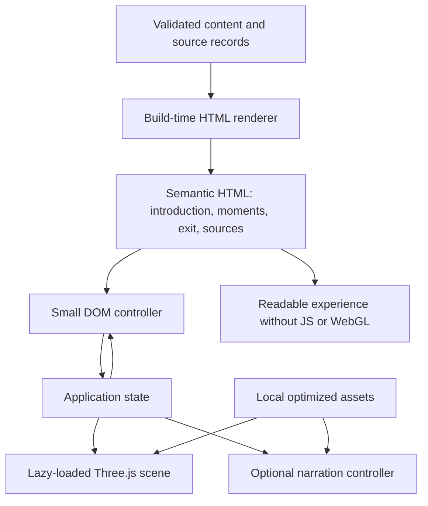

# After 632 — architecture and implementation plan

**Purpose:** Give the next coding agent an executable plan for building the experience described in `HANDOFF.md`.

**Planning date:** October 10, 2026 (America/Chicago).

**Repository inspected:** commit `84dbb63`; only `HANDOFF.md` existed before this document. No application, package manifest, assets, or tests were present.

**Status:** Architecture only. Implementation and device testing have not occurred.

The handoff is the product brief. This document translates it into implementation decisions; proposed stack choices, budgets, copy, and timings below are recommendations, not previously approved requirements. If a technical decision changes, update this document and preserve the handoff's historical, experiential, and accessibility boundaries.

## 1. Product contract

Build a short, self-paced, standalone web experience for early college students in the United States. One imagined courtyard remains recognizable while students visit 632, 661, and 680 CE. Changes in sunlight support short passages about authority, succession, and remembrance. The visit should invite approximately six minutes of attention without timers, locked progression, or compulsory interaction.

Students should leave understanding that Sunni and Shi'a Muslims share central foundations, that disagreements over leadership developed over time, and that early history does not independently explain a modern conflict. The exit provides two dated Yemen reports and one open question. The separate 250–500 word course reflection remains outside this application.

### Non-negotiable boundaries

- Identify the courtyard as an **interpretive setting**, not a reconstruction of Medina, Karbala, a mosque, or any documented site.
- Do not depict Muhammad, early leaders, Husayn, worshippers, or combatants. Do not invent dialogue or simulate religious voices.
- Do not stage battles, contemporary violence, ritual, or a sudden branching Sunni–Shi'a split. Avoid representing one tradition as light and the other as darkness.
- Do not imply that two fully formed denominations existed by 680 or that seventh-century events directly caused a particular modern battle.
- Keep each dated moment's main passage at 60 words or fewer. Source details belong in optional disclosures.
- Let students revisit any date and leave at any time. Do not add quizzes, scores, collecting, sect selection, completion gates, accounts, or response grading.
- Support keyboard, touch, captions, reduced motion, visible movement bypass, and a readable experience without WebGL or audio.
- Keep student work, secrets, and unpublished course material out of this public repository. Do not collect reflection text.

## 2. Architectural decisions

| Decision | Implementation default | Reason |
| --- | --- | --- |
| Delivery | One static HTML entry point plus locally bundled JS, CSS, and media | Deployable on ordinary static hosting without an application server |
| Meaning of standalone | A self-contained `dist/` folder served over HTTP(S); no runtime CDN dependency | The brief does not require a literal single-file download or `file://` support |
| Stack | TypeScript, Vite, Three.js, vanilla semantic HTML/CSS | Small application with explicit ownership and no framework requirement |
| Dependencies | Pin compatible versions at implementation time; commit one npm lockfile | Reproducible builds; do not guess current version numbers from this document |
| 3D navigation | Bounded orbit around a fixed courtyard focal point | Easier to operate and test than free walking or collision physics |
| Content rendering | Build-time HTML generated from validated content data | Historical content and links remain available when JS or rendering fails |
| State | Small typed reducer/store, no state-management package | One selected moment, presentation preferences, renderer status, and narration status |
| Rendering | One scene, one camera, one courtyard; change light presets | Preserves spatial continuity and keeps resource costs low |
| Audio | Optional prerecorded neutral narration, added after the historical experience works | No autoplay or runtime voice generation; text remains authoritative |
| Persistence | In-memory state only for v1 | No student tracking or storage dependency; reload returns to the opening |
| Backend | None | No database, login, API keys, AI API, CMS, or LMS integration is needed |
| Deployment | Build static artifacts; document host configuration and rollback | Actual host is not specified and should not determine the experience architecture |

If a single downloadable HTML file becomes an explicit requirement, treat asset inlining and its size tradeoffs as a separate packaging change. Do not silently promise that double-clicking the source HTML will run ES modules and media.

### System structure



The renderer never owns historical copy or navigation. The UI never modifies scene objects directly. The scene receives a selected preset and motion policy. Narration receives a moment ID and an explicit user playback request.

## 3. Experience and screen structure

### 3.1 Opening

Show the title, approximate visit length, setting label, and the exact opening question:

> When a community loses the person who united it, what gives someone else the authority to lead?

Proposed setting copy: “An imagined courtyard: an interpretive setting, not a reconstruction of a documented place.”

Offer **Enter the courtyard** and **Read without 3D**. The opening and reading option must render before any texture or Three.js download completes. Do not require audio selection or an onboarding tutorial. Provide a short instruction near the scene: “Drag to look around, or use the view buttons. Choose a date to move through time.”

### 3.2 Courtyard and historical moments

- Desktop: courtyard and a calm, opaque reading panel within the same page; date navigation stays visible.
- Phone: bounded scene area above the passage and controls, with normal vertical page scrolling. Do not force fullscreen or lock orientation.
- Show three date buttons: **632 CE**, **661 CE**, **680 CE**. Indicate the current date with text and `aria-pressed`, not color alone.
- Previous/next buttons are optional conveniences. Disable at the first/last date rather than wrapping unexpectedly. Date buttons always allow direct selection.
- Include **Reset view**, **Look left**, **Look right**, **Look up**, **Look down**, **Pause movement**, **Skip movement**, and **Read without 3D** with accessible labels. Group secondary view controls compactly.
- Keep the setting label and a brief shared-foundations statement near the experience. Put expanded historical notes and sources in native `<details>` elements.
- Provide an always-available **Continue to the reports** anchor. Access to the exit never depends on visiting all dates.
- Keep text selectable and inside the DOM. Never put essential text into a texture or canvas overlay.

Suggested visit rhythm: opening 30–45 seconds, each historical moment 60–75 seconds, and exit 60–90 seconds. These are usability targets, not enforced delays. The exit introduces reports; reading both full articles is outside the six-minute target.

### 3.3 Exit

Use an ordinary page section, not a physical gate that requires camera navigation. Render two source cards with publisher, verified headline, full publication date, and a descriptive link. If there is a correction/update date, distinguish it from publication date. Do not embed news pages, autoplay video, or reuse news photography without permission.

Include concise context that the Houthis have a Zaydi Shi'a background, distinct from Iran's Twelver Shi'a tradition; religious labels alone do not explain Yemen's political history. Link the supporting Brookings source.

Use the exact invitation:

> What does this older history help you notice, and what would you still need to learn about this conflict?

Below it, a quiet note may explain that the course reflection happens separately using the course materials and reporting. Do not provide an essay field, AI chat, generated answer, assignment checklist, or submission button. Link back to the courtyard and to the source shelf.

### 3.4 Reading mode and no-JavaScript behavior

Reading mode contains the opening, all three dated passages in order, shared foundations, interpretive caveats, the two reports, invitation, and sources. No educational information depends on 3D, sound, animation, hover, or a downloaded image.

Generate this HTML during both development serving and production build with the same Vite `transformIndexHtml` helper. The source `index.html` is a template; the built `dist/index.html` must contain actual text and links. Escape content when inserting HTML. Use a structured link model rather than arbitrary raw HTML in content data.

Without JavaScript, display every passage and native anchor navigation. With JavaScript, reveal enhancement-only buttons after handlers are ready; hide inactive passages only when interactive mode is successfully established. When 3D fails, remove any hiding and expose all passages. Do not leave a blank canvas, hidden article, or loading spinner as the final state.

## 4. Historical content and source governance

### 4.1 Proposed starting copy

The following passages are **draft implementation copy**, grounded in the handoff and its textbook source. They still need a documented historical/editorial check before being labelled reviewed. Do not reproduce contested claims about succession as universally accepted facts.

**632 CE — Succession**

> After Muhammad died in 632, Abu Bakr became the first caliph, the leader of the Muslim community. Supporters of Ali understood rightful leadership differently. The question of who should lead, and on what grounds, would shape later disagreements within Islam.

**661 CE — Political struggle**

> Ali died in 661, and Umayyad rule took shape under Mu'awiya. Disagreement over leadership developed through political struggles within the Muslim community. These events were part of a longer history; Sunni and Shi'a traditions did not emerge fully formed in a single moment.

**680 CE — Karbala and remembrance**

> Husayn, Muhammad's grandson and Ali's son, was killed at Karbala in 680. His death became central to Shi'a remembrance of injustice and rightful leadership. Here, changes in light mark a moment for reflection; this imagined courtyard does not recreate Karbala or its violence.

**Shared-foundations draft:** “Sunni and Shi'a Muslims belong to Islam and share central beliefs and practices, including belief in one God, the Qur'an, and prayer. Their traditions developed over time.”

**Historical-note brief:** Explain that the three dates illuminate origins, with later differences in religious authority and practice beyond this short experience. Attribute perspectives, use respectful spelling consistently, and link textbook sections 8.6.1, 8.8, and 8.9. Do not import images of historical figures from sources just because they are available there.

### 4.2 Source register

Source checks below were performed during this planning task on October 10, 2026, using the available browser tool. “Accessible” is not a full scholarly endorsement, comprehensive fact-check, or guarantee of future access.

| ID | Source and locator | Purpose | Planning check / next action |
| --- | --- | --- | --- |
| HIST-01 | Brian Parkinson, [chapter 8, World History: Cultures, States, and Societies to 1500](https://alg.manifoldapp.org/read/world-history/section/b5b7defa-a694-4cff-bdc7-cc550c80af5d), §§8.6.1, 8.8, 8.9 | Shared foundations and three historical moments | Accessible; succession and Karbala sections inspected. Review final wording and attributed perspectives before release. |
| VIS-01 | Metropolitan Museum of Art, [Islamic art educator resource, Unit 1](https://www.metmuseum.org/-/media/files/learn/for%20educators/publications%20for%20educators/islamic%20teacher%20resource/unit1.pdf), printed p. 37, PDF p. 9 | Broad courtyard and palm-branch shade context | Relevant passage inspected. This is context, not a blueprint or permission to label the scene a reconstruction. |
| NEWS-01 | Associated Press, [May 6, 2025 report](https://www.ap.org/news-highlights/spotlights/2025/trump-says-the-us-will-stop-bombing-yemens-houthis-after-rebels-say-theyll-stop-targeting-ships/) | First exit report | Accessible; publication date and subject confirmed. Show its actual date; it is dated reporting, not a current live account. |
| NEWS-02 | Associated Press, [report labelled October 2026 in the handoff](https://apnews.com/article/yemen-houthis-iran-saudi-mandeb-hormuz-oil-67d70a6b39c0c4fb3149e3f3981805ee) | Intended second exit report | Tool could not access the exact URL; targeted search did not verify that exact article. Exact headline, full date, and contents remain unverified. This does not prove the article is nonexistent. |
| CTX-01 | Allison Minor, [2024 Brookings paper on the Yemen war](https://www.brookings.edu/wp-content/uploads/2024/09/Minor_How-the-US-could-have-prevented-the-Yemen-War_2024.pdf), printed p. 5, PDF p. 8 | Yemen's political context and Zaydi/Twelver distinction | Accessible; relevant distinction inspected. Use as background, not one of the two news reports. |
| PED-01 | Marc Watkins, [Reading in an Age of Thinking Machines](https://marcwatkins.substack.com/p/reading-in-an-age-of-thinking-machines) | Attention and independent interpretation | Carried from handoff; not independently inspected in this task. No runtime dependency. |
| ASSET-01 | [Poly Haven license](https://polyhaven.com/license) | Asset licensing and provenance | Carried from handoff. Confirm individual asset provenance and current terms when selecting downloads; credit Poly Haven. |
| TECH-01 | [Three.js documentation](https://threejs.org/docs/) | Renderer and controls implementation | Carried from handoff. Read docs matching installed version during implementation. |

**News release condition:** Resolve NEWS-02 by checking the exact article in a normal browser or selecting a verifiable replacement that meets the same Yemen-report purpose. Record any replacement and its rationale. Never invent a headline, infer an exact date from a URL, or ship an unverified card as factual. Draft previews may show an honest unavailable-source notice, but a release must contain two verified reports.

The handoff calls for recent news while supplying a May 2025 article for an October 2026 concept. Preserve the supplied article as the initial intended selection and date it clearly. Before course release, confirm whether it meets the instructor's recency window; replace it if necessary. Do not silently label it “latest.”

Record for each source: ID, publisher/author, title, URL, publication date if known, locator, check date, status (`pending`, `verified`, `unavailable`, or `replaced`), and a short review note. A `verified` source record means its identity and relevant contents were checked; historical copy has a separate review status. Recheck reporting and links before each course term. No runtime news scraping or automatic substitutions.

## 5. Code layout and ownership

Proposed files to create during implementation:

```text
HANDOFF.md                         original product brief
ARCHITECTURE.md                    this plan; update decisions as implemented
README.md                         setup, build, deploy, source-refresh instructions
package.json / package-lock.json  scripts and pinned dependency graph
tsconfig.json / vite.config.ts    strict typing; build-time HTML hook; relative asset base
index.html                        document template, landmarks, static-content marker
content/
  experience.json                 introduction, passages, notes, exit invitation
  sources.json                    citations, dates, verification records
  assets.json                     asset paths, origins, licenses, credits, sizes
scripts/
  content.ts                      validation and escaped static HTML rendering
src/
  main.ts                         bootstrap; retain readable HTML on any failure
  styles.css                      responsive layout, focus, reduced motion
  app/types.ts                    shared contracts
  app/state.ts                    reducer; normalized motion and presentation state
  app/controller.ts               dispatch, effects, lifecycle coordination
  ui/bindControls.ts              DOM events, labels, focus behavior
  ui/renderState.ts               selected passage/date and status updates
  scene/createScene.ts            renderer, resize, lifecycle, resource disposal
  scene/buildCourtyard.ts         geometry/material construction; stable layout
  scene/presets.ts                immutable 632/661/680 light presets
  scene/motion.ts                 cancellable transitions and render scheduling
  scene/viewControls.ts           bounded orbit and keyboard-equivalent buttons
  audio/narration.ts              one audio element; playback and cue synchronization
public/assets/
  textures/                      optimized local textures
  environment/                   optional lighting-only HDRI
  audio/                         optional narration and timing files
tests/
  content.test.ts                 word limits, references, dates, release conditions
  state.test.ts                   transitions, failure recovery, motion policy
  experience.spec.ts             meaningful browser flows and failure injection
docs/
  validation.md                  measured performance and usability evidence
  content-review.md              reviewed claims, source locators, unresolved issues
```

Keep content validation/rendering usable from the Vite hook and test scripts without importing browser code. Use one canonical content dataset for generated HTML and narration scripts. Browser code can bind to generated `data-moment-id` attributes; do not duplicate historical prose in TypeScript components.

Suggested scripts: `dev`, `typecheck`, `check:content`, `check:release`, `test`, `test:e2e`, `build`, and `preview`. `build` validates structural content and builds a reviewable preview; `check:release` additionally rejects pending historical review and missing/unverified news cards. Document that a successful build alone is not release readiness.

### Core data contracts

```ts
type MomentId = '632' | '661' | '680';
type ReviewStatus = 'draft' | 'reviewed';

interface MomentContent {
  id: MomentId;
  year: 632 | 661 | 680;
  title: string;
  body: string;                 // plain text, <= 60 whitespace-delimited words
  sourceIds: string[];
  reviewStatus: ReviewStatus;
  narration?: {
    src: string;               // local file, fetched only after playback request
    transcript: string;        // must match the approved passage
    cues: { start: number; end: number; text: string }[];
  };
}

interface NewsCard {
  id: string;
  sourceId: string;
  headline: string;
  publishedOn: string | null;   // ISO date; null while unverified
  updatedOn?: string;
  status: 'pending' | 'verified' | 'unavailable' | 'replaced';
  checkedOn: string | null;
}

interface ExperienceState {
  moment: MomentId;
  mode: 'reading' | 'interactive';
  sceneStatus: 'idle' | 'loading' | 'ready' | 'failed' | 'disposed';
  motionPreference: 'system' | 'paused';
  systemReducedMotion: boolean;
  transition: 'idle' | 'running';
  narration: 'idle' | 'loading' | 'playing' | 'paused' | 'error';
}
```

Validate the ID/year pairing, unique IDs, canonical order, source references, publication-date format, local media paths, cue ordering, and word limits. Require exactly two verified news cards at release. Do not count citation labels, date headings, or optional notes toward the passage limit; do not use those exclusions to hide additional mandatory reading.

## 6. Interaction and lifecycle rules

### 6.1 Moment selection

1. Receive `SELECT_MOMENT(id)` from a date button or previous/next control.
2. Validate the ID; ignore selection of the already-selected moment.
3. Stop/reset narration and invalidate pending playback requests for the old moment.
4. Cancel any previous visual transition and retain its current interpolated values.
5. Update selected date and passage immediately; keep focus on the activating control.
6. Announce only the date/title through a small polite live region. Do not announce the whole passage or every caption cue.
7. If motion is allowed and the scene is ready, transition light parameters to the new preset. Otherwise snap to that preset and render once.
8. Finish without advancing time, starting audio, or changing camera orientation automatically.

Rapid selection must leave the newest selection in charge. Use a generation token or cancellable transition handle so stale asset/audio promises cannot mutate current state. Going backward restores the same preset; no destructive geometry changes occur.

### 6.2 Controls and preferences

| Input | Required behavior |
| --- | --- |
| Drag on scene | Bounded orbit; no pointer lock, pan, or free flight |
| Touch | Prefer horizontal drag with vertical page scrolling preserved; no blanket page `preventDefault` |
| View buttons | Small bounded orbit steps; usable with Tab and Enter/Space |
| Reset view | Return to initial camera pose; snap if motion is paused/reduced |
| Pause movement | Snap active transition to selected preset and disable future interpolation until resumed |
| Skip movement | Finish the current transition immediately; keep the selected moment and passage |
| System reduced motion | Start and remain with instant state changes, no damping/ambient animation; respond to preference changes |
| Read without 3D | Stop animation/audio, expose all reading sections, retain selected date as a return target |
| Return to 3D | Reinitialize if disposed, apply the selected preset, keep audio paused |
| Continue to reports | Move to the exit heading; no new scene, locked gate, or forced fade |

Effective motion is disabled when the system requests reduced motion **or** the user has paused movement. Resuming does not override the system setting. The no-motion path still permits deliberate immediate camera steps and full date navigation.

### 6.3 Renderer lifecycle and failure recovery

- Lazy-load the scene module only after **Enter the courtyard**. Keep the DOM usable during loading; scene preparation must not block controls or scrolling.
- If initialization is unsupported, throws, or exceeds a proposed 10-second timeout, retain reading mode with a short factual notice and a manual retry action. Ignore late results after timeout/disposal.
- Texture/HDRI errors fall back to plain materials and simple lights. They do not require abandoning the entire scene.
- On WebGL context loss, stop rendering, preserve the selected moment, show reading mode, and offer **Try 3D again**. Recovery recreates resources deliberately; do not retry indefinitely.
- Handle resizing with `ResizeObserver`; update camera aspect and renderer dimensions without changing selection. Clamp device pixel ratio.
- Suspend frame work when hidden or offscreen. Pause narration when the document becomes hidden; require user action to resume it. Returning to the page must not produce a large time jump.
- Render on demand during dragging, settling, or a finite transition; stop requesting frames when stable. Avoid a permanent idle loop.
- On disposal, cancel animation frames and asynchronous work, remove listeners/observers, dispose controls, geometries, materials, textures, environment maps, and renderer resources. Re-entry must not accumulate duplicate canvases or audio elements.

## 7. Courtyard and art direction

Use warm earth, muted vegetation, quiet shadows, and open space. Proposed starting dimensions are an approximately 18-by-14-unit rectangle with low plain walls, a ground plane, a simple shaded edge, and two or three sparse plants. These are composition choices, not archaeological claims. Adjust them after the first prototype.

Construct walls from boxes, ground from a plane, shade supports from simple cylinders/boxes, and palm-like shade from a few restrained planes or slats. Use shared materials and geometry where possible. No imported character models or Blender pipeline is necessary.

Keep the camera at a comfortable, approximately eye-level view focused inside the courtyard. Constrain distance and polar/azimuth ranges so a student cannot orbit through walls, underground, or into a view dominated by blank wall backs. Select final bounds from the actual geometry; a fixed default camera must already show a satisfying composition.

| Moment | Suggested visual preset | Interpretation limit |
| --- | --- | --- |
| 632 | Soft warm light, legible ground and shaded edge | Begin with openness, not a literal sky reconstruction |
| 661 | Shift sun angle and shadow direction; slightly firmer contrast | Signal time and political change without damaging or dividing the courtyard |
| 680 | Lower, restrained light and gentler contrast | Reflection without blood-red effects, blackout, sound of violence, or reenactment |

Use approximately 1–1.5 seconds for a user-triggered light transition as an initial design setting. No continuous sun cycle or automatic date progression is required. Explicit dates carry chronology; sun position is a visual metaphor, not astronomical evidence.

Begin with flat materials and a directional plus hemisphere light. Add at most a few 1–2K local Poly Haven textures only after the first milestone is clear and fast. If using an HDRI, use it for environment lighting with a plain/procedural background; never display a photographed landscape as an Arabian setting. Avoid domes, minarets, ornate tilework, prayer niches, religious inscriptions, and decorative objects that imply an identified mosque.

Every downloaded asset needs an `assets.json` record with source URL, creator/provider, license, downloaded date, local variants, and file size. Preserve license notices for dependencies and give Poly Haven visible credit. No runtime hotlinks, embedded news images, or external fonts are necessary. Use system fonts and strong editorial typography.

## 8. Audio and captions

Audio is an enhancement that must never delay the historical milestones. The first complete text/3D version may ship without narration because the handoff makes it optional. If added:

1. Record the reviewed passages using a neutral contemporary explanatory voice; no historical impersonation, invented speech, devotional performance, or dramatic combat soundscape.
2. Use one HTML audio element, `preload="none"`, and explicit Play/Pause/Replay controls. Start only from a user gesture. Handle rejected `play()` promises.
3. Fetch only the selected track; changing dates stops and resets the old track. Never autoplay the next moment.
4. Keep the full passage visible whether audio is available, paused, loading, or broken. Provide visible synchronized sentence captions while playing and a full transcript at all times.
5. Drive cue selection from actual `audio.currentTime`, including after seeking/replay. Caption content must match the recording and contain no extra historical claims.
6. Avoid automatically sending captions to a screen-reader live region; the readable passage already provides the content and duplicated announcements interfere with listening.
7. On audio failure, show a concise notice, retain text, and offer retry. On leaving interactive mode or selecting another moment, invalidate late playback promises.

Do not use browser speech synthesis as an unreviewed substitute for recording. Background music and ambient sound are outside the v1 default.

## 9. Accessibility and performance acceptance targets

### Accessibility

Target WCAG 2.2 AA behavior and verify manually as well as with automated checks; do not claim certification from an automated score.

- Semantic landmarks, one page title, ordered headings, skip-to-content link, visible focus, and meaningful source-link text.
- Standard buttons/anchors with keyboard behavior. No canvas keyboard trap or document-wide arrow interception. All camera actions have button equivalents.
- Canvas is supplementary and can be `aria-hidden="true"`; nearby DOM text supplies the setting description and all educational information. Its controls remain separately accessible.
- Opaque reading surfaces retain at least 4.5:1 body-text contrast regardless of scene lighting; large text/UI boundaries meet applicable contrast requirements.
- Aim for 44-by-44 CSS pixel touch targets with adequate spacing. Controls wrap at narrow widths and remain visible at 200% zoom. Check reading mode reflow at 400% zoom.
- Do not rely on color, animation, sound, or pointer gestures to identify the active date or reach content.
- Support reduced motion, paused movement, portrait/landscape, keyboard-only use, and a screen reader. No flashes or auto-moving camera.
- Switching to reading mode must not remove the focused element without a destination; move focus to the corresponding reading heading when necessary. Opening disclosures follows native behavior.

### Proposed engineering budgets

These are starting acceptance targets, not measured results. Record actual device, browser, viewport, network profile, and transfer sizes in `docs/validation.md`.

| Area | Initial target / fallback |
| --- | --- |
| Initial readable HTML/CSS/controller | At most 200 KB compressed transfer before the optional 3D request; no external font |
| Initial 3D session | At most 5 MB total transferred including code and selected optimized textures; exclude opt-in audio |
| Loading | Readable page within about 2 seconds on a documented simulated mobile network; usable courtyard within about 5 seconds after entry under that profile |
| Interaction | Date text updates immediately; ordinary DOM actions should remain responsive within about 200 ms |
| Rendering | Aim for 30 FPS or better during interaction on a representative ordinary phone/laptop; render no idle frames once stable |
| Complexity | Start below 100 draw calls and 100,000 rendered triangles; inspect Three.js renderer statistics |
| Resolution | Default DPR cap 1.5; lower to 1 on constrained devices if measured performance requires it |
| Shadows | One modest directional shadow map if affordable; low-quality tier removes dynamic shadows |
| Low-quality tier | Plain materials/simple lights, reduced DPR, no HDRI and no decorative animation; identical content |
| Narration | Small compressed per-moment files loaded on demand; no whole-library preload |

Tune budgets based on observed hardware, not user-agent assumptions. A 1–2K texture can still consume significant decoded GPU memory; track resource reuse and disposal as well as transfer size. Do not introduce postprocessing, physics, particles, service workers, or a global asset preload unless a measured need justifies them.

## 10. Phase-by-phase implementation

Work in the following dependency order. Each phase ends with a reviewable result and evidence. A phase is complete only when its exit criteria pass; visual polish does not substitute for content or accessibility.

### Phase 0 — Confirm content and implementation baseline

**Depends on:** This document and `HANDOFF.md`.

1. Read repository instructions, inspect the working tree, and preserve unrelated changes. Confirm that the repo is still unimplemented.
2. Create a short decision record in the README for the static folder, vanilla TypeScript/Vite/Three.js stack, and orbit navigation defaults.
3. Create the content/source schema and register every source from §4.2. Keep source-access status separate from historical-copy review.
4. Check the 632 draft against the cited textbook and the handoff's attributed-perspective requirements; record reviewer/date/locators and any unresolved issues.
5. Start verification of NEWS-02 and the term's news recency requirement. This can remain unresolved during local prototyping, but must be tracked for release.
6. Define what counts as the “ordinary laptop/phone” used for baseline validation; record available real devices and any emulation limits.

**Deliverables:** Source register, first content record, recorded defaults, review notes.

**Exit criteria:** 632 passage is historically checked or its specific unresolved claims are identified and corrected before the first milestone is accepted. No invented news metadata enters the content model.

### Phase 1 — Static, accessible foundation

**Depends on:** Phase 0's content structure.

1. Initialize the minimal project and lockfile; enable strict TypeScript and the scripts in §5.
2. Implement content validation and the shared HTML-rendering helper used by Vite in dev/build.
3. Build the opening, setting label, shared-foundations text, 632 passage, source disclosure, and reading-mode structure.
4. Add responsive CSS, semantic landmarks, skip link, focus styles, and reduced-motion rules.
5. Add the small state/controller layer and progressive enhancement initialization. Keep enhancement-only buttons hidden until bound.
6. Create the scene interface boundary and loading/error UI without allowing renderer errors to hide content.
7. Add meaningful content validation and a no-JavaScript browser check against the built site.

**Deliverables:** Readable static page and enhancement scaffold.

**Exit criteria:** A built page works with JavaScript disabled, at narrow widths, and by keyboard. It contains real 632 text and sources. No textures, audio, or WebGL are required to read it.

### Phase 2 — First implementation milestone: one courtyard + 632

**Depends on:** Phase 1 and reviewed 632 content.

1. Lazy-load Three.js on entry and build the full primitive courtyard, shaded area, modest vegetation, lights, and a stable camera composition.
2. Add constrained orbit, view buttons, reset, movement pause/bypass, resize handling, and the 632 light preset.
3. Wire the DOM and scene through the state/controller interface; retain the static reading path.
4. Implement initialization failure, context-loss fallback, disposal, and visibility handling now rather than postponing them to final QA.
5. Test keyboard, touch scrolling, reduced motion, WebGL unavailable, re-entry, and initial performance on the recorded baseline devices.
6. Review the experience for spaciousness and legibility. Confirm students can identify the courtyard as imagined and explain the leadership question without reading implementation notes.
7. Adjust composition, text placement, controls, and geometry cost based on findings; record evidence.

**Deliverables:** One complete courtyard and one historically checked moment.

**Exit criteria:** 632 is clear and accessible, the courtyard is fast enough on baseline hardware, and fallback recovery works. Resolve blocking clarity/performance issues **before adding the other moments or sound**. If student observation is unavailable, record it as pending rather than claiming it happened.

### Phase 3 — Three moments in one space

**Depends on:** Phase 2's clarity/performance gate.

1. Review and add 661 and 680 content, citations, and explanatory notes; enforce the passage limit.
2. Add the remaining light presets while reusing the existing geometry and camera pose.
3. Implement direct date selection, previous/next if used, bounded cancellable transitions, and current-date announcements.
4. Ensure reduced motion, Pause movement, and Skip movement each follow §6 without blocking navigation.
5. Test 632 → 680 → 661 → 632, repeated same-date activation, and rapid selections. Confirm the newest selection controls both passage and light.
6. Audit visuals/text for gradual historical development, shared Muslim foundations, and the absence of a sect-coded visual split.
7. Verify all three passages are present in the generated reading mode and no-JavaScript page.

**Deliverables:** Complete historical journey with reversible time navigation.

**Exit criteria:** All moments can be reached in any order, no forced wait exists, historical text and lighting agree, and every date is equally usable without animation.

### Phase 4 — Exit, reports, and source shelf

**Depends on:** Phase 3; source research may have started in Phase 0.

1. Resolve the intended second report or document a verifiable replacement; verify full metadata for both cards.
2. Confirm the May 2025 article is acceptable for the intended course term or choose a dated replacement and record why.
3. Add both cards, the open reflection question, and the brief Zaydi/Twelver and political-context note.
4. Make the exit accessible from the opening, every moment, and reading mode. Add return navigation.
5. Add the source shelf, optional historical note, and credits; source links must remain normal usable anchors.
6. Enable `check:release` requirements for two verified news cards, reviewed historical passages, and resolved source IDs.
7. Manually open the report URLs; automation alone cannot establish that a publisher page is readable or the correct article.

**Deliverables:** End-to-end text and 3D experience with complete exit context.

**Exit criteria:** Two verified, clearly dated reports are present and the course work remains external. If source access remains blocked, the preview stays usable but release is explicitly incomplete.

### Phase 5 — Restrained visual refinement and optional narration

**Depends on:** Phase 4's end-to-end behavior; no unresolved first-milestone performance defects.

1. Add only the textures or environment light that improve the reviewed primitive composition; optimize local files and record provenance.
2. Ensure any HDRI is lighting-only, scene geometry is unchanged across dates, and reading contrast is stable.
3. Re-measure the load and rendering budgets after asset additions; remove costly detail before accepting regressions.
4. If narration is in scope and recordings are available, implement the single-player contract, controls, synchronized captions, and transcripts from §8.
5. Test blocked playback, missing tracks, switching moments while audio loads, replay, and mute/silent use. Confirm a stale track cannot begin after a date change.
6. Document whether this release includes narration. If it does not, omit nonfunctional audio controls and leave all text visible.

**Deliverables:** Finished atmosphere, asset credits, and optional working narration.

**Exit criteria:** Refinements preserve performance and cultural restraint; no mandatory information depends on audio or downloaded visual assets.

### Phase 6 — Integrated verification and learner review

**Depends on:** All selected features implemented.

1. Run content/release validation, typechecking, targeted unit tests, browser tests, and production build.
2. Check the built artifact rather than only the dev server, including a nested static-host path and a page refresh.
3. Execute the acceptance matrix in §11 across available Chromium, Firefox, and Safari/WebKit coverage, including a real phone when possible.
4. Run automated accessibility checks, then manually use keyboard and a screen reader. Inspect zoom/reflow, focus, captions, and motion settings.
5. Measure cold loading, active frame rate, draw calls, memory/resource behavior across repeated 3D/reading switches, and idle/background work.
6. Observe a few representative learners when available. Ask whether the setting is reconstructed, what changed between dates, what Muslims share, and what further information Yemen requires. These are usability research prompts outside the product, not a new in-app quiz.
7. Record actual visit duration without enforcing it. Fix confusing controls, misleading historical impressions, or pacing that feels empty/slow.
8. Log untested devices and pending human review honestly. Re-run only the affected checks after fixes.

**Deliverables:** `docs/validation.md`, resolved defects, and reviewed release checklist.

**Exit criteria:** Required flows pass, release source checks pass, and material limitations are documented. No claim of learner validation without observed learners.

### Phase 7 — Package, deploy when authorized, and hand off

**Depends on:** Phase 6's release gate.

1. Produce `dist/` and a README explaining clean install, development, production build, preview, content editing, asset credits, and source refresh.
2. Confirm the artifact contains no credentials, unpublished course material, student text, or unnecessary third-party requests.
3. Document static hosting needs: correct MIME types, relative/subpath-safe asset URLs, compressed assets, and sensible caching (short-lived HTML, hashed build assets cached longer).
4. Add deployment steps for the selected host once known. Publication itself is a separate action and is not required by this architecture-writing task.
5. When deployment is authorized, smoke-test the actual URL for assets, fallback, keyboard navigation, date selection, and outgoing reports. Keep the previous artifact available for rollback.
6. Update this plan with actual versions, decisions that changed, tested devices, content/source check dates, narration scope, and remaining follow-up work.

**Deliverables:** Reproducible static package and final coding-agent handoff; deployed URL only if deployment occurs.

**Exit criteria:** Another agent can build and preview from a clean checkout and can update course-term reporting without changing the renderer.

## 11. Acceptance and verification matrix

| ID | Scenario | Required evidence | Phase |
| --- | --- | --- | --- |
| A01 | Open the built page with JS disabled | All implemented historical content, setting label, and source links are visible; final version includes exit and all dates | 1, 6 |
| A02 | First complete courtyard | Reviewed 632, full spatial composition, usable controls, and measured device performance | 2 |
| A03 | WebGL absent/initialization fails/context lost | Readable content stays available; no endless spinner; manual retry is bounded | 2, 6 |
| A04 | Date changes in both directions and rapidly | Newest date/passage/preset agree; no stale audio or transition wins | 3, 6 |
| A05 | Keyboard-only and screen reader | Every action reachable, logical focus, concise announcements, no trap | 2, 6 |
| A06 | Reduced motion and movement controls | No unwanted interpolation/damping; direct date selection and instant view controls still work | 2, 3, 6 |
| A07 | Phone scrolling, resizing, zoom | No clipped text, blocked scroll, or unusable controls; normal reading flow survives | 2, 6 |
| A08 | Audio disabled, blocked, failed, or switched mid-load | Complete readable content; explicit playback; no old track starts | 5, 6 if audio exists |
| A09 | Texture or HDRI request fails | Plain-material courtyard remains usable; history unaffected | 5, 6 |
| A10 | Background tab and repeated mode switches | Rendering suspends; no accumulating canvases/listeners/resources; playback stays user-controlled | 2, 6 |
| A11 | Historical/cultural audit | No depictions, invented voices, sudden split, direct modern causation, or reconstruction claim; shared foundations explicit | 0–6 |
| A12 | Exit reports | Exactly two verified reports with exact dates/headlines; both URLs manually opened; Zaydi/Twelver context sourced | 4, 6 |
| A13 | Word limits and generated content | Each main passage <=60 words; generated DOM and narration transcript match canonical reviewed content | 1, 3, 5 |
| A14 | Cold load and interaction on baseline hardware | Recorded transfer sizes, load profile, active FPS, draw calls, and fallback behavior meet targets or justified adjustments | 2, 5, 6 |
| A15 | Visit and reflection boundary | Approximately six-minute self-paced exploration possible; no assignment automation or content gates | 6 |
| A16 | Static build under a subpath | Production asset requests succeed, refresh works, and no API/server runtime is required | 6, 7 |

Use Vitest (or the smallest equivalent compatible with the chosen tooling) for content/reducer invariants and Playwright for important browser flows. Tests should cover failures and behavioral contracts, not snapshot every mesh or mirror implementation details. Keep live external-link checks separate from deterministic CI tests; publisher access can fail independently of application code.

## 12. Risks, decisions still open, and how to proceed

| Item | Current position | Action / blocking boundary |
| --- | --- | --- |
| Exact October 2026 AP article unavailable to research tool | Unverified, not declared false | Verify or replace before release; do not block the courtyard prototype |
| Definition of “recent” reporting | No course-term window specified | Check at content release; preserve exact dates and record replacements |
| Historical/editorial review | Draft copy supplied; no instructor sign-off claimed | Complete and document the 632 check before milestone acceptance, then the remaining passages before release |
| Hosting provider | Unspecified | Build portable static artifacts now; choose deployment configuration later |
| Literal single-file/offline download | Not requested explicitly | Default to static folder; add special packaging only if required |
| Narration assets and pronunciation | Not supplied | Text-first build can proceed; audio remains optional and reviewed |
| Texture/HDRI selections | Not supplied | Start with primitives/plain materials; choose a small licensed set after the first milestone |
| Browser/device baseline | Not measured yet | Establish and report actual available hardware in Phase 0/2 |
| Learner observation | Not performed in this planning task | Arrange during verification if available; record any remaining validation gap |

These open items do not require redesigning the architecture. Use the defaults above for reversible implementation choices and record changes. Never mark an unresolved content dependency complete just because the site builds.

## 13. Instructions to the next coding agent

1. Read `HANDOFF.md`, this document, and applicable repository instructions. Inspect the current tree before creating files.
2. Begin with Phases 0 and 1, then deliver **Phase 2's complete courtyard and reviewed 632 moment** as the first meaningful implementation milestone.
3. Validate clarity, accessibility, and performance before adding 661, 680, or sound.
4. Keep historical content, sources, renderer, UI, and optional narration separate through the contracts above.
5. Continue in phase order, maintain a concise progress record, and label blocked source/review items accurately.
6. Finish with a clean build, evidence against §11, and instructions another agent can follow. Do not treat the unresolved news link, optional audio, or a missing deployment target as a reason to leave independent implementation work undone.

The completed experience should let a student enter an explicitly imagined shared space, revisit three carefully framed dates, reach reliable sources in any supported mode, and leave with a question they will investigate themselves.
