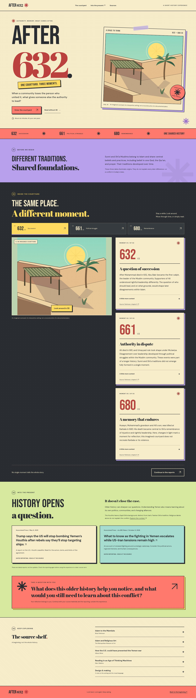

# After 632

An imagined courtyard, three moments in early Islamic history, and an invitation to keep asking questions.

A static, accessible TypeScript experience with a photographic visual treatment. The imagined courtyard is rendered in Blender Cycles using Poly Haven CC0 materials and sky lighting. A small Three.js viewer lets visitors look around the three rendered panoramas. These are images of an invented setting, not photographs of a documented historical place.

**Live preview:** [After 632 on GitHub Pages](https://wangy113.github.io/after-632-gpt-sol-6/).



The [interactive courtyard view](docs/preview-courtyard.jpg) and [mobile layout](docs/preview-mobile.jpg) are captured from the production build.

## Run locally

Use Node.js 22.12+ (Node 24 is the tested version):

```sh
npm ci
npm run dev
```

Open the URL printed by Vite. For a production preview:

```sh
npm run build
npm run preview
```

Upload the **contents of `dist/`** to any static HTTP(S) host. Asset URLs are relative so a repository subpath works. This is a self-contained static folder, not a single-file `file://` application. No backend, environment variables, account, or API key is required. The Pages workflow builds `main` and updates the `gh-pages` branch, which GitHub Pages serves.

## What works

- A full photographic opening, restrained typography, and neutral page colors.
- Opt-in panoramic courtyard with detailed rendered geometry, bounced light, bounded pointer controls, and equivalent keyboard-accessible view buttons.
- 632, 661, and 680 CE passages; direct selection in either direction and cancellable sunlight transitions.
- Reading mode with a dated courtyard photograph for each moment, complete built HTML with JavaScript disabled, and recovery from unavailable WebGL or context loss.
- Reduced-motion support, pause/skip movement, and rendering that stops when idle, offscreen, or in a background tab.
- Shared Muslim foundations, historical/source notes, two dated AP reports, and an open reflection invitation.
- Locally bundled fonts, dependency license notices, and no external runtime asset requests.

Narration is optional in the brief and is not included in this version. There is no autoplay or inactive audio UI; all historical passages are always available as text. The interactive view loads three local panoramic images on entry. The Poly Haven maps are the offline render inputs; there are no runtime requests to Poly Haven. The visitor looks from one fixed camera position. Date changes blend between separately rendered lighting conditions in the same scene.

## Checks

```sh
npm run typecheck
npm run check:content
npm run check:release
npm test
npx playwright install chromium
npm run build
npm run test:e2e
```

If a suitable Chromium is already installed, set `PLAYWRIGHT_CHROMIUM_EXECUTABLE_PATH` for the test command instead of downloading another browser. Browser tests start a production preview on port 4173 when one is not already running. A passing `check:release` checks content structure and source records; it does not certify historical accuracy, cross-browser access, real-device performance, or classroom readiness.

See [validation evidence](docs/validation.md), the [first milestone record](docs/milestone-1.md), and [content review notes](docs/content-review.md) for results and remaining human/device checks.

## Editing content

| File | Purpose |
| --- | --- |
| `content/experience.json` | Opening, shared foundations, three passages, optional notes, final invitation |
| `content/sources.json` | Historical and contextual citations, locators, check dates |
| `content/news.json` | Exactly two exit reports, exact publication dates, checked links |
| `content/assets.json` | Artwork, Poly Haven, font, and library provenance |
| `scripts/content.ts` | Validation and escaped build-time HTML rendering |
| `src/main.ts` / `src/state.ts` | DOM enhancement, lifecycle coordination, state |
| `src/scene/createScene.ts` | Panorama projection, date transitions, bounded look controls, disposal |
| `scripts/render-courtyard.py` | Reproducible detailed courtyard scene and Cycles render settings |
| `scripts/process-render.py` | Render denoising and WebP asset conversion |
| `src/styles.css` | Typography, color, responsive layout, focus, reduced motion |

Keep each main historical passage at 60 words or fewer. Attribute differing understandings of authority carefully. Recheck all reporting and the instructor's recency requirements before a new term. The May 2025 report is retained from the handoff and is never labelled the latest news. The October 6, 2026 AP report links to its verified ABC News syndication because direct AP access failed in the research tool; its original URL is preserved in the data.

Restart the dev server after editing content JSON. It uses the same build-time renderer as production. Never add student posts, credentials, or unpublished course materials to this public repository.

## Build and contribution boundaries

The product brief is [HANDOFF.md](HANDOFF.md). [ARCHITECTURE.md](ARCHITECTURE.md) records the phased plan and an implementation update. The first complete courtyard/632 slice was checked before adding the later moments. The photographic edition replaces the primitive browser geometry with rendered views. Learner observation and instructor review remain separate steps.

Before course use, complete the pending checks in `docs/validation.md`. Optional follow-up work includes reviewed prerecorded narration with synchronized captions and testing on real student laptops/phones. Keep the reflection outside the application; do not add quiz scoring or automated essay writing.

## Recreate the photographs

See [photographic rendering](docs/photographic-rendering.md) for the scene source, render tools, and asset pipeline. Normal development and production builds use the committed WebP files and do not require Blender.
