# WebGL2 geometry baseline · 2026-10-14

The plan targets roughly **under 150 draw calls and 800,000 triangles per frame on Balanced, including the shadow pass**. This is a baseline for the current gray-box room, not a Balanced-tier or shadow-inclusive result.

Run from a clean checkout with Node.js 22.12 or later and system Chromium available:

```sh
npm ci
PLAYWRIGHT_CHROMIUM_EXECUTABLE_PATH=/usr/bin/chromium npm run measure:geometry
```

The command builds the production bundle, serves it locally, and opens Chromium 154 with SwiftShader's WebGL2 fallback (`?gl=1&metrics=1`). It fixes the viewport at 1440 × 900 CSS pixels, device pixel ratio 1, reduced motion, the default Qwantani morning sky, and an 864 × 486 canvas buffer. At each date it samples the starting doorway and yard camera poses. After each selection it turns right and back left, then reads the settled frame's counters; this also warms the rendering path. Date dissolves and place glides are bypassed by reduced motion. The opt-in `metrics` query copies `renderer.info.render` values onto the canvas as `data-draw-calls`, `data-triangles`, and `data-render-calls` immediately after a visible frame.

| Date | Place | Draw calls | Triangles | Renderer calls |
| --- | --- | ---: | ---: | ---: |
| 632 | Doorway | 61 | 3,077 | 2 |
| 632 | Yard | 67 | 3,273 | 2 |
| 661 | Doorway | 35 | 2,949 | 2 |
| 661 | Yard | 53 | 3,545 | 2 |
| 680 | Doorway | 33 | 2,501 | 2 |
| 680 | Yard | 48 | 2,781 | 2 |

The highest sampled draw count is **67** and the highest sampled triangle count is **3,545**; they occur in different frames. No sampled frame exceeds either numerical target. These counters represent issued draw calls and submitted mesh triangles, including the fullscreen output draw used for tone mapping. They do not measure shaded pixels, GPU time, or frame rate. The three.js r186 renderer runs its own animation tick and normally resets these counters there; measurement mode disables that reset, resets immediately before each application frame, and reads the totals immediately after it. Shadow draws would enter the same counters through nested renderer calls.

**No shadow pass runs on a normal visit.** The renderer leaves `shadowMap.enabled` at its default `false`, and the directional light does not cast shadows. Mesh `castShadow` flags alone do not start one. The prototype also has no Balanced quality tier. This baseline therefore cannot establish the plan's shadow-inclusive performance budget. It excludes the two offscreen scene renders that prepare an animated date dissolve and the intervening fullscreen blend frames; those are separate transient costs. The other two standing places, real WebGPU hardware, a Chromebook, and a phone were not sampled here.

## Small diagnostic shadow check · 2026-10-14

The `?shadows=1` flag enables one directional shadow pass for inspection; it is off on normal visits. This diagnostic uses a 1024 × 1024 shadow map and a 20-unit-wide orthographic shadow camera. Run the normal measurement command above, then:

```sh
PLAYWRIGHT_CHROMIUM_EXECUTABLE_PATH=/usr/bin/chromium npm run measure:geometry -- --shadow-doorway
```

With the same production build and 632 doorway pose, the default frame measured **61 draw calls, 3,077 triangles, and 2 renderer calls**. The diagnostic shadow frame measured **90 draw calls, 4,393 triangles, and 3 renderer calls**: an increase of 29 draws and 1,316 submitted triangles. The extra renderer call confirms that the shadow pass ran. The shadow frame remains below the plan's numerical draw and triangle limits, but this single gray-box pose does not validate the future Balanced tier or other views. Frame time has not been reviewed.

## Matched doorway shadow images · 2026-10-14

Run `PLAYWRIGHT_CHROMIUM_EXECUTABLE_PATH=/usr/bin/chromium npm run capture:shadow-pair` to build and capture the default and `?shadows=1` views. The script fixes the 632 doorway camera at `(0, 1.6, 0.5)`, yaw `0`, pitch `-0.3`, with the Qwantani morning sky, 1440 × 900 viewport, DPR 1, reduced motion, and WebGL2 via SwiftShader. Both canvas buffers are 864 × 486. It checks that the pose matches and the shadow capture has one extra renderer call. The linked PNGs include the same 864 × 487 CSS canvas area:

| Default: shadows off | Diagnostic: shadows on |
| --- | --- |
| [View full-size image](632-doorway-shadow-off.png) | [View full-size image](632-doorway-shadow-on.png) |
| 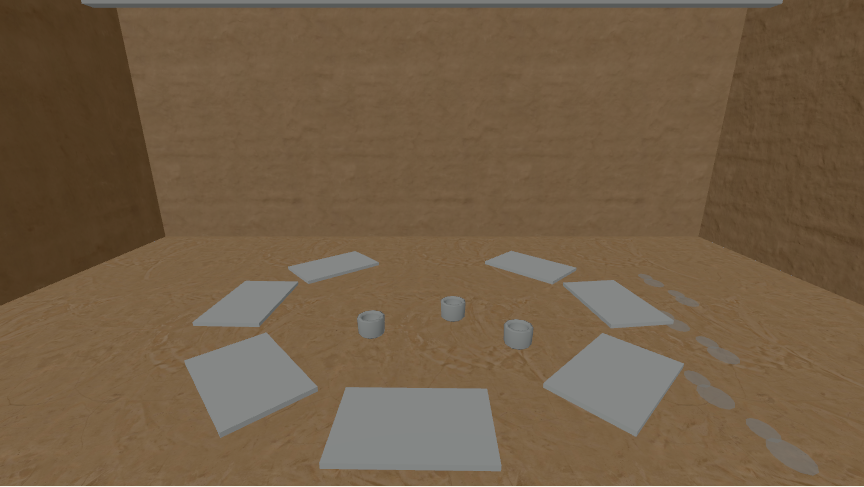 | 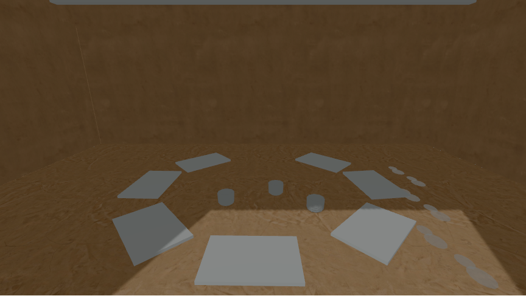 |

In this pair, the shadow pass darkens the back wall and much of the floor. A bright, hard-edged doorway patch crosses the near floor and sharp prop shadows draw attention toward it. The unfinished mat circle, three cups, and footprints on the right remain visible, but the mats and cups separate less clearly from the darker floor. No object disappears or changes position. A narrow bright line along the left wall edge is visible in the shadow image; the image alone does not establish whether it is a shadow-map artifact or a geometry/light leak.

Keep shadows off on normal visits. Before widening this diagnostic to other dates or viewpoints, investigate that wall edge and a less dominant light/shadow balance at the same pose, then check that the three imagined traces stay legible. This one software-rendered view cannot establish real-device performance or the future Balanced tier.

## Left-wall shadow line probe · 2026-10-14

The line follows the junction of the left and back wall boxes. Those boxes overlap at the corner, and the default shadow-off image has no corresponding bright line. To test the shadow calculation at that exact pose, temporarily change only the diagnostic directional light's shadow settings in `src/world/room.ts`, then run the capture command above for each variant. Each run passed the same camera-pose checks and measured 2 renderer calls without shadows and 3 with shadows. Restore the source setting and the original `632-doorway-shadow-on.png` after saving each variant:

| Diagnostic setting | Same-pose capture | Observation at the left/back wall corner |
| --- | --- | --- |
| Baseline: 1024 × 1024 map, bias 0 | [Baseline](632-doorway-shadow-on.png) | A faint, narrow bright line follows the corner. |
| 2048 × 2048 map, bias 0 | [Larger map](632-doorway-shadow-2048.png) | The line remains in the same place; its pixels shift slightly. |
| 1024 × 1024 map, bias −0.001 | [Negative bias](632-doorway-shadow-bias-neg001.png) | The line becomes visibly brighter. |
| 1024 × 1024 map, bias +0.001 | [Positive bias](632-doorway-shadow-bias-pos001.png) | The line is still faintly visible, but less pronounced. |

At image pixel `(155, 185)`, near the middle of the line, baseline RGB is `(82, 60, 36)`, negative bias is `(91, 68, 44)`, and positive bias is `(81, 59, 35)`; a nearby wall pixel `(150, 185)` stays `(77, 57, 33)` in all three. A larger map moves the brightest pixel at this row from `x=155` to `x=154` without removing the line. In three.js's shadow comparison, negative bias makes this receiver easier to light and positive bias makes it harder. The opposite responses identify the visible line as sensitive to shadow depth comparison, not an open visible gap in the room mesh. They do **not** establish whether the overlapping wall junction, shadow filtering, or depth precision creates that near-threshold comparison. Doubling the map resolution alone did not solve it.

The default diagnostic settings and normal shadow-off visit are unchanged. No bias adjustment has been adopted: this probe only narrows the cause, and the hard floor patch and trace contrast still need visual review before any wider shadow use. A next focused probe can change which wall casts or receives diagnostic shadows at this corner, capture the same pose, and restore the wall settings afterward.

## Left/back wall caster and receiver probe · 2026-10-14

The previous bias test narrowed the bright line to the shadow comparison at the wall junction. This probe temporarily changed one wall's `castShadow` or `receiveShadow` flag **only when `diagnosticShadows` was true** in `src/world/room.ts`. Each variant ran `capture:shadow-pair` at the same 632 doorway pose, passed a production build, and still measured 2 renderer calls with shadows off and 3 with them on. The original source and baseline captures were restored after each run.

| Diagnostic variant | Capture | Observation |
| --- | --- | --- |
| Both walls cast and receive shadows | [Baseline](632-doorway-shadow-on.png) | A narrow bright line follows the left/back junction. |
| Left wall does not cast | [View full image](632-doorway-shadow-no-left-caster.png) | The line opens into a broad bright wedge on the back wall near the corner. |
| Back wall does not cast | Same as baseline | The entire 864 × 487 PNG is byte-for-byte identical to the baseline capture (SHA-256 `7fde0d2d5e3e25506deb5c904bf63bf897e19f0d5526413931e7637eebe03c7d`). |
| Back wall does not receive | [View full image](632-doorway-shadow-no-back-receiver.png) | The back wall brightens, and the narrow shadow line is no longer isolated at its left edge. |

At pixel `(155, 185)` on the original line, baseline RGB is `(82, 60, 36)`. It becomes `(114, 91, 65)` when the left wall does not cast or the back wall does not receive. The nearby left-wall pixel `(150, 185)` stays `(77, 57, 33)` in all three. These matched captures identify the **left wall as the relevant caster and the back wall as the receiver** for this line. The back wall's own casting has no visible effect at this pose. The result does not yet distinguish a contact edge formed by the overlapping boxes from shadow-map precision or filtering at that edge. Removing the left caster or back receiver is not a usable fix: each creates a much larger bright area.

Normal visits and the baseline `?shadows=1` settings remain unchanged. Before adopting shadows more widely, a focused geometry-junction test can adjust the left/back wall overlap in the diagnostic scene, capture the same pose, then restore it. The hard floor patch and three trace contrasts still need review.

## Flush left/back wall junction probe · 2026-10-14

The left wall normally spans `z=-5.1..0.1`; the back wall's front face is at `z=-5.0`, leaving a 10 cm overlap in depth at the corner. For one **temporary diagnostic-only** test, shorten the left wall box from 5.2 to 5.1 units and move its center from `z=-2.5` to `z=-2.45`. Its front edge stays at `z=0.1`, while its rear edge meets the back wall front face at `z=-5.0`. The shadow-off geometry stays on its original dimensions. Run `capture:shadow-pair` at the same fixed 632 doorway pose, save the shadow-on capture below, then restore the original geometry and baseline captures.

| Baseline | Flush diagnostic junction |
| --- | --- |
| [Full image](632-doorway-shadow-on.png) | [Full image](632-doorway-shadow-flush-left-wall.png) |

The following crop shows image pixels `x=105..189, y=20..264` enlarged 4× with nearest-neighbor scaling; the left panel is baseline:

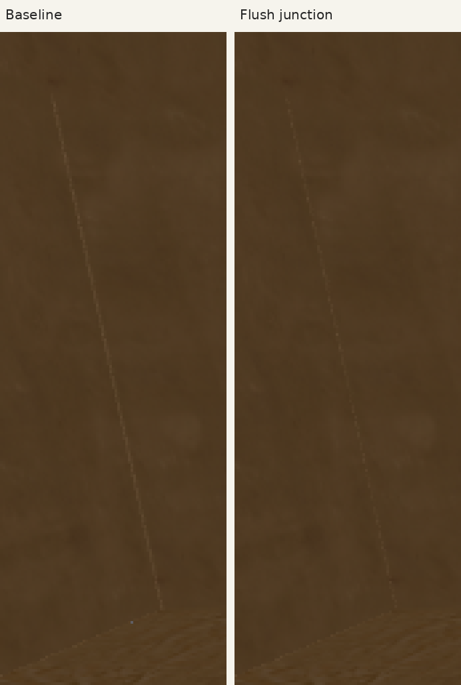

The flush-junction capture passed the same pose checks and measured 2 renderer calls with shadows off and 3 with them on. The bright line becomes a faint dotted trace, but it does not disappear. At pixel `(155, 185)`, RGB changes from `(82, 60, 36)` to `(79, 58, 33)`; the nearby wall pixel `(150, 185)` remains `(77, 57, 33)`. Differences in the full images are confined to `x=0..166, y=0..304`; sampled central back-wall and floor regions are unchanged. The full image shows no broad new light wedge.

This establishes that the junction geometry influences the line at this pose. It does not establish a finished correction: the rear cap of the shortened left wall is coplanar with a strip of the back wall's front face, and the remaining dotted line may reflect contact depth or shadow filtering. The temporary geometry was restored, leaving normal visits and the opt-in diagnostic unchanged. A later geometry trial should use a joined corner without overlapping or coplanar faces before considering a permanent shadow change.

## Cap-free flush junction probe · 2026-10-14

The flush probe above left the left wall's hidden rear cap coplanar with part of the back wall. To test that cap, temporarily use the same diagnostic-only flush dimensions (`depth=5.1`, center `z=-2.45`) and omit the left BoxGeometry's final six indices, which form its two rear (`-z`) triangles. Keep the other five faces and their shadow casting. The shadow-off room remains unchanged. Run `capture:shadow-pair` at the fixed 632 doorway pose, then restore the source and baseline PNGs.

| Baseline | Flush with cap | Flush without rear cap |
| --- | --- | --- |
| [Full image](632-doorway-shadow-on.png) | [Full image](632-doorway-shadow-flush-left-wall.png) | [Full image](632-doorway-shadow-flush-no-rear-cap.png) |

This crop uses the same `x=105..189, y=20..264` pixels enlarged 4× with nearest-neighbor scaling:

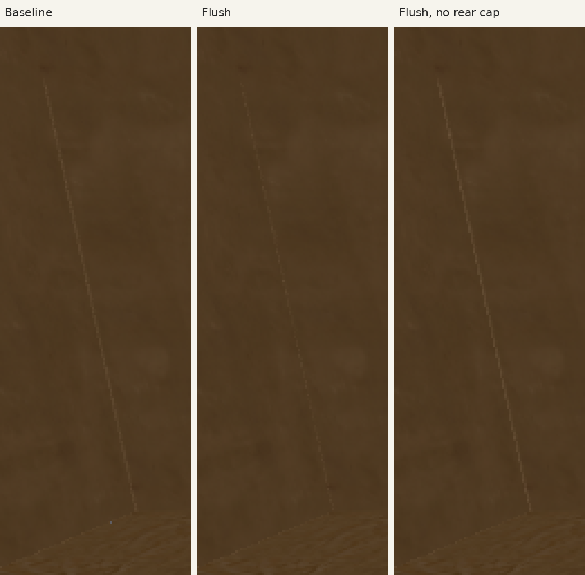

The cap-free capture passed the same pose checks and measured 2 renderer calls with shadows off and 3 with them on. Removing the cap brings back a continuous bright line, stronger at some pixels than baseline. At `(154, 185)`, RGB is `(84, 62, 38)` at baseline, `(79, 58, 34)` with the flush cap, and `(93, 71, 46)` without it; the nearby wall pixel `(150, 185)` stays `(77, 57, 33)`. The cap-free and capped flush captures differ only within `x=124..166, y=43..236`, around the line. The full image shows no broad new wedge.

The coplanar rear cap is therefore **not the sole source** of the bright line. In this pose its presence partly suppresses the line, likely through its shadow contribution; removing it is not a visual fix. The original geometry and captures were restored, so normal visits and the baseline diagnostic remain unchanged. Further work should test the shadow sampling/filtering at this receiver edge or design a joined corner, rather than adopt either temporary wall shape.

## VSM shadow comparison · 2026-10-14

For one temporary `?shadows=1` comparison, set the renderer's shadow-map type to three.js r186 `VSMShadowMap` instead of its default `PCFShadowMap`. Leave the room geometry, light, shadow-map size, and camera pose unchanged. VSM adds two blur renders, so the temporary capture assertion expected 2 renderer calls with shadows off and 5 with them on instead of the baseline 2 / 3. Run `capture:shadow-pair`, save the VSM image, then restore the renderer, capture assertion, and baseline PNGs.

| PCF baseline | VSM diagnostic |
| --- | --- |
| [Full image](632-doorway-shadow-on.png) | [Full image](632-doorway-shadow-vsm.png) |

The corner crop uses the same `x=105..189, y=20..264` pixels enlarged 4× with nearest-neighbor scaling:

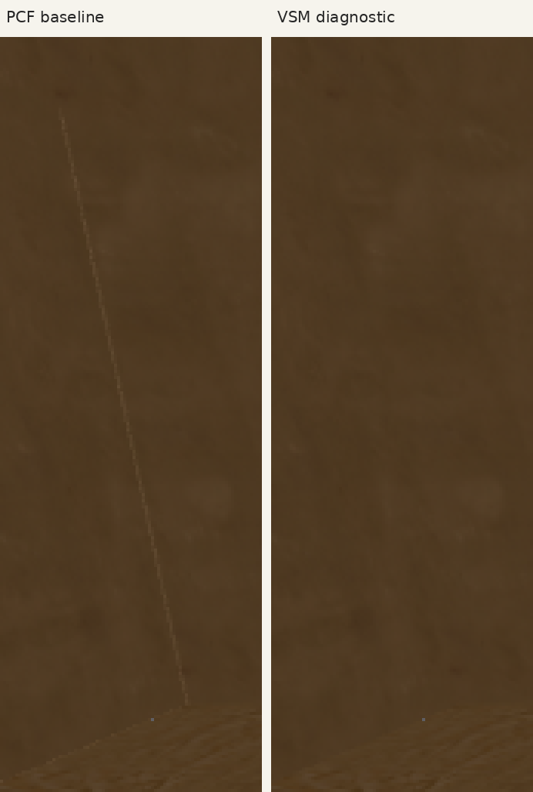

The capture passed the matched 632 doorway pose checks and measured **2 / 5 renderer calls**. The narrow corner line is no longer visible in the VSM crop. At `(154, 185)`, PCF RGB is `(84, 62, 38)` while VSM is `(78, 57, 33)`, close to the neighboring wall pixel `(150, 185)` at `(77, 57, 33)`. The bright near-floor patch remains prominent, though its boundary and some prop-shadow edges look slightly softer. The mat circle, three cups, and right-side footprints remain visible; no prop moves or disappears in the matched images.

This is a promising visual result at one software-rendered pose, **not an adopted setting**. VSM adds two renderer calls and changes the shadow pipeline's caster handling as well as filtering, so the image does not isolate filtering as the sole cause of the missing line. GPU time, real-device behavior, other views, and the planned Balanced tier remain unmeasured. The baseline PCF diagnostic and normal shadow-off visits were restored.

## VSM doorway submission counts · 2026-10-14

Run the existing `measure:geometry -- --shadow-doorway` command at the 632 doorway first with baseline PCF, then with `renderer.shadowMap.type = THREE.VSMShadowMap` temporarily set only for `?shadows=1`. The script builds a production bundle for each run, uses Chromium 154's SwiftShader WebGL2 fallback at 1440 × 900, DPR 1, reduced motion, and an 864 × 486 canvas buffer. It returns the camera to yaw `0`, pitch `-0.3` before reading a settled frame. Restore PCF and rebuild after the VSM measurement.

| 632 doorway mode | Draw calls | Submitted triangles | Renderer calls |
| --- | ---: | ---: | ---: |
| Normal visit, shadows off (previous baseline) | 61 | 3,077 | 2 |
| Diagnostic PCF, fresh run | 90 | 4,393 | 3 |
| Temporary diagnostic VSM, fresh run | 99 | 4,479 | 5 |
| VSM increase over PCF | **9** | **86** | **2** |

The additional submissions match the renderer's VSM path: two fullscreen blur draws (one triangle each) plus seven receiving mats that VSM also includes in the shadow-caster pass (seven 12-triangle boxes). PCF includes only meshes marked to cast. The two blur passes explain the extra renderer calls. The VSM row remains under the plan's numerical limits of 150 draw calls and 800,000 submitted triangles **at this one gray-box pose**. These counters do not measure shaded pixels, blur shader samples, render-target bandwidth, frame time, GPU time, or a real device, so they cannot establish the planned Balanced-tier performance. The baseline PCF diagnostic and normal shadow-off visit remain unchanged.

## Live shadow-filter preview · 2026-10-14

The production preview now makes the two diagnostic filters selectable by URL: [`?shadows=1` uses PCF](https://wangy113.github.io/after-632-gpt-sol-6/?shadows=1), and [`?shadows=1&shadowFilter=vsm` uses VSM](https://wangy113.github.io/after-632-gpt-sol-6/?shadows=1&shadowFilter=vsm). Open either link, enter the room, and select the same date and place to compare. `shadowFilter=vsm` by itself leaves shadows off, as do normal visits. Other filter values retain the PCF diagnostic.

The browser check fixes the 632 doorway pose in WebGL2 via SwiftShader and observes 2 renderer calls with shadows off, 3 with PCF, and 5 with VSM after a look. Those counts confirm the diagnostic selection on that path. The matched images and submission counts above remain the visual and numerical evidence; the public link does not establish frame time, real-device behavior, or suitability of the still-bright floor patch.

## Matched 661 doorway filter review · 2026-10-14

From a fresh production build, open the PCF and VSM diagnostic URLs above in separate Chromium 154 pages, select 661, then look right and left to settle the scene before capturing the canvas. Both captures use the Qwantani morning sky, 1440 × 900 viewport, DPR 1, reduced motion, and SwiftShader WebGL2. The camera matches at `(0, 1.6, 0.5)`, yaw `0`, pitch `-0.3`; both canvas buffers are 864 × 486. The PCF frame makes 3 renderer calls, the VSM frame 5. Both pages completed without script or request failures, and the images differ.

| 661 doorway, PCF | 661 doorway, VSM |
| --- | --- |
| [Full-size image](661-doorway-shadow-pcf.png) | [Full-size image](661-doorway-shadow-vsm.png) |
| 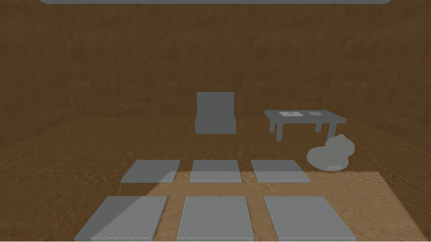 | 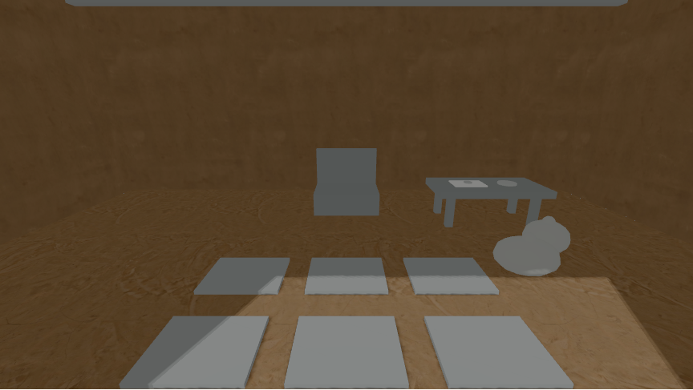 |

The narrow bright mark at the left/back wall junction is visible in PCF and not apparent in VSM at this pose. The bright near-floor patch remains conspicuous in both; VSM softens its boundary slightly but does not fix the lighting balance. Both mat rows remain visible, though their fine striping is much less apparent in VSM. The plain seat, low table, and travel cluster on the right remain in place in both images. The letter and coin are small marks on the table, and individual travel objects cannot be identified at this distance. The pegs and hook are outside this doorway view.

This is one software-rendered 661 view. It supports further review of the 680 doorway, not adopting either shadow mode for normal visits. No source renderer or room settings changed for these captures.

## Matched 680 doorway filter review · 2026-10-14

From a fresh production build, open the PCF and VSM diagnostic URLs above in separate Chromium 154 pages, select 680, then look right and left to settle the scene before capturing the canvas. Both captures use the Qwantani morning sky, 1440 × 900 viewport, DPR 1, reduced motion, and SwiftShader WebGL2. The camera matches at `(0, 1.6, 0.5)`, yaw `0`, pitch `-0.3`; both canvas buffers are 864 × 486. The PCF frame measured 85 draws / 3,909 submitted triangles / 3 renderer calls; VSM measured 87 / 3,911 / 5. The pair differs in pixels and both pages completed without script or request failures.

| 680 doorway, PCF | 680 doorway, VSM |
| --- | --- |
| [Full-size image](680-doorway-shadow-pcf.png) | [Full-size image](680-doorway-shadow-vsm.png) |
| 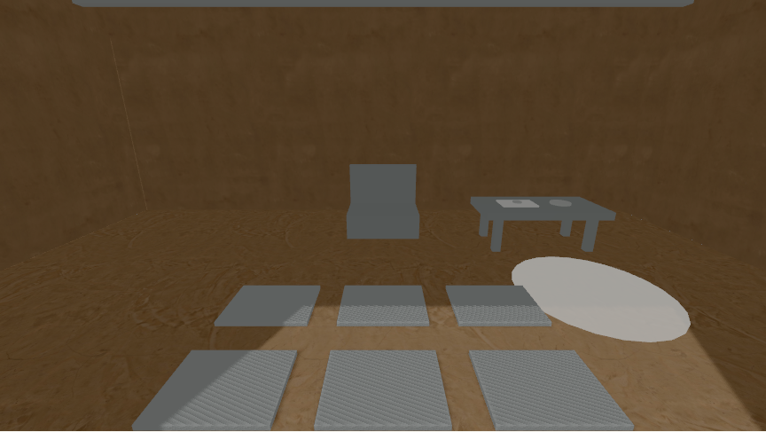 | 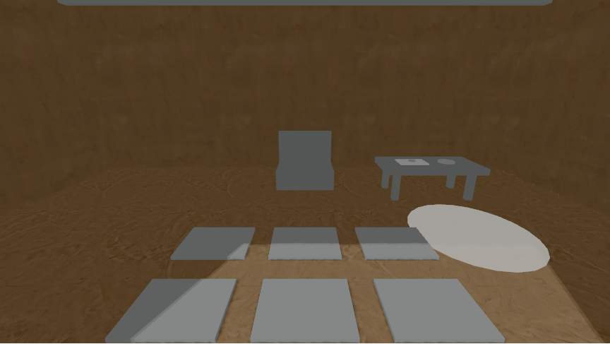 |

The intended clean floor patch stays a distinct pale oval beside the right mat row in both images. Its curved edge separates it from the broad angular sunlit area that enters from the foreground. The oval is nearly featureless white in both filters. PCF shows a sharper boundary around the sunlit area and a thin bright line at the left/back wall junction. VSM softens the floor boundary slightly and the wall line is not apparent, but the sunlit area remains visually prominent. All six mats remain visible; their fine striped pattern is strong in PCF's lit portions and much less apparent under VSM. The rear seat and right table remain visible, but their small tabletop marks cannot be identified at this distance.

The empty hook and wall outline, the pegs, and the taller yard palm are outside this straight doorway view. No object disappears or large clipped area is apparent in this pair. This is a software-rendered visual review of one pose, not a real-device performance, historical suitability, or student legibility result. Normal visits remain shadow-free, and PCF remains the diagnostic default. No renderer or room source changed for these captures.

## Matched 680 pegs filter review · 2026-10-14

From a fresh production build, open the PCF and VSM diagnostic URLs above in separate Chromium 154 pages, select 680 and the pegs place, then look right and left to settle the scene before capturing the canvas. Both captures use the Qwantani morning sky, 1440 × 900 viewport, DPR 1, reduced motion, and SwiftShader WebGL2. The camera matches at `(2, 1.6, -1.35)`, yaw `1.571`, pitch `-0.1`; both canvas buffers are 864 × 486, while the captured PNGs are 864 × 487. PCF measured 76 draws / 3,737 submitted triangles / 3 renderer calls; VSM measured 78 / 3,739 / 5. The pages completed without script or request failures, and the images differ.

| 680 pegs, PCF | 680 pegs, VSM |
| --- | --- |
| [Full-size image](680-pegs-shadow-pcf.png) | [Full-size image](680-pegs-shadow-vsm.png) |
| 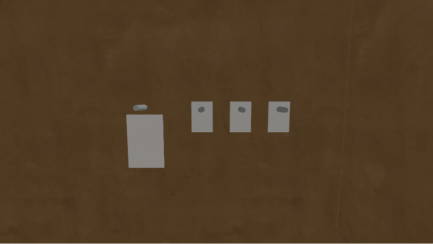 |  |

The bare hook is individually visible above the tall pale waterskin outline on the left. Three separate dark pegs remain visible against three smaller pale rectangular traces across the center and right. None is clipped or missing. The hook, pegs, and traces look unchanged between the filters; the visible pixel differences are confined to a faint, narrow strip along the far-right vertical wall seam, away from the traces. VSM offers no legibility gain at this pose.

This 680 pair shows the empty hook, but cannot by itself establish the 661-to-680 disappearance of the waterskin; see the matched 661 pegs view below for the earlier state. The clean floor patch and taller yard palm are outside this frame. This is one software-rendered visual review, not a real-device performance or student legibility result. Normal visits remain shadow-free, PCF remains the diagnostic default, and no renderer or room source changed for these captures.

## Matched 661 pegs filter and date review · 2026-10-14

From a fresh production build, open the PCF and VSM diagnostic URLs above in separate Chromium 154 pages, select 661 and the pegs place, then look right and left to settle the scene before capturing the canvas. Both captures use the Qwantani morning sky, 1440 × 900 viewport, DPR 1, reduced motion, and SwiftShader WebGL2. The camera matches the 680 pegs captures at `(2, 1.6, -1.35)`, yaw `1.571`, pitch `-0.1`; both canvas buffers are 864 × 486, while the PNGs are 864 × 487. PCF measured 83 draws / 4,621 submitted triangles / 3 renderer calls; VSM measured 85 / 4,623 / 5. The pages completed without script or request failures.

| 661 pegs, PCF | 661 pegs, VSM |
| --- | --- |
| [Full-size image](661-pegs-shadow-pcf.png) | [Full-size image](661-pegs-shadow-vsm.png) |
| 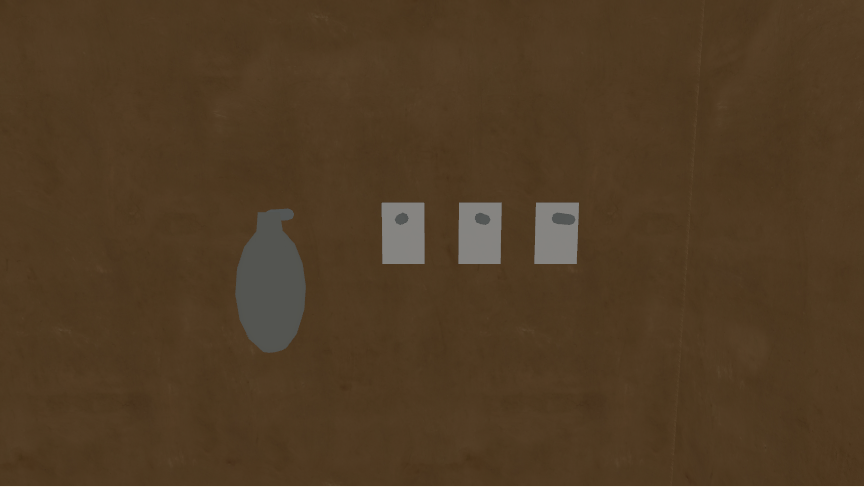 |  |

The gray waterskin body and neck occupy the left hook area at 661. In the [matched 680 pair](#matched-680-pegs-filter-review--2026-10-14), that area shows a bare hook above a tall pale wall outline. The three smaller pegs remain bare and individually visible against their pale traces at both dates. Comparing PNG pixels within each filter localizes every 661-to-680 change to `x=235..327, y=208..352`, around the waterskin and outline. The floor bags are outside this close wall frame, so these captures do not assess their visibility.

The 661 PCF and VSM images differ only along the faint far-right wall seam (`x=668..704`), away from the waterskin and pegs. Neither filter changes their apparent legibility or clips them at this pose. This pair confirms the implemented visual change between the dates; the objects and traces are invented interpretation, not evidence of historical belongings. It is a software-rendered visual review, not a real-device performance or student legibility result. Normal visits remain shadow-free, PCF remains the diagnostic default, and no renderer or room source changed for these captures.

## Matched 661 and 680 floor-bag review · 2026-10-14

From a fresh production build, open the PCF diagnostic URL above in separate Chromium 154 pages for 661 and 680. Select the head-of-room place, look left five times and down once, then capture the settled canvas. Both captures use the Qwantani morning sky, 1440 × 900 viewport, DPR 1, reduced motion, and SwiftShader WebGL2. The camera matches at `(-1.55, 1.6, -3.65)`, yaw `2.042`, pitch `-0.340`; both canvas buffers are 864 × 486 and PNGs are 864 × 487. The 661 frame measured 108 draws / 5,689 submitted triangles / 3 renderer calls, and 680 measured 99 / 4,357 / 3. Both pages completed without script or request failures, and the images differ.

| 661 floor bags, PCF | 680 floor trace, PCF |
| --- | --- |
| [Full-size image](661-bags-shadow-pcf.png) | [Full-size image](680-bags-shadow-pcf.png) |
| 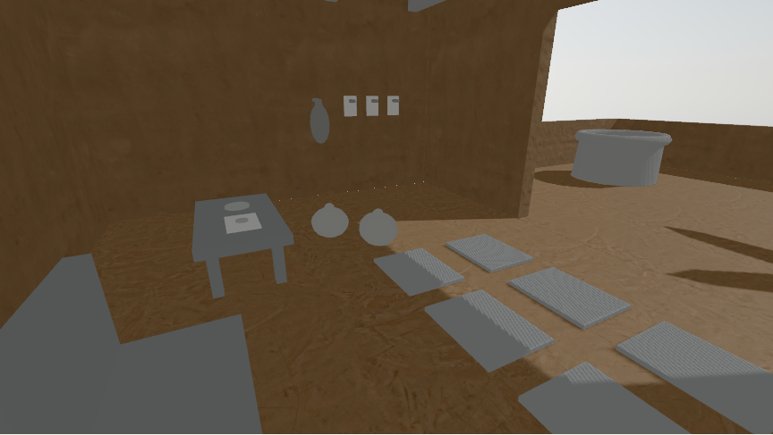 | 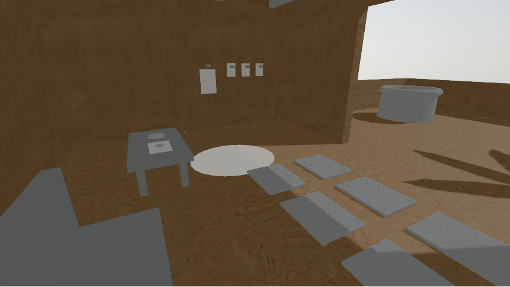 |

At 661, two separate gray rounded bag forms sit between the low table and nearest mat row. Their silhouettes do not touch or clip the frame, though this view does not show construction details. Both forms are absent at 680. A broad, bright, nearly featureless oval floor trace occupies their former area; its curved edge remains visible beside the table and nearest mat. The table and mat row remain, while the waterskin on the wall changes to the empty hook and pale outline already seen in the pegs pair. Yard and right-floor shadows also change by date, so the full-frame difference is not limited to the bags. No obvious new shadow artifact appears around the bags or oval in this PCF pair.

These are invented interpretive objects and traces, not evidence of historical belongings. This one software-rendered PCF view establishes the implemented visual change, not student legibility, real-device performance, or VSM behavior at this camera. Normal visits remain shadow-free, PCF remains the diagnostic default, and no renderer or room source changed for these captures.

## Matched 632 travel-corner follow-up · 2026-10-14

From a fresh production build, open the PCF diagnostic URL above in Chromium 154, select 632 and the head-of-room place, then look left five times and down once before capturing the settled canvas. This matches the [661/680 bag pair](#matched-661-and-680-floor-bag-review--2026-10-14) at camera `(-1.55, 1.6, -3.65)`, yaw `2.042`, pitch `-0.340`. The capture uses the Qwantani morning sky, 1440 × 900 viewport, DPR 1, reduced motion, and SwiftShader WebGL2. Its canvas buffer is 864 × 486 and the PNG is 864 × 487. It measured 91 draws / 4,605 submitted triangles / 3 renderer calls, completed without script or request failures, and differs from both later-date images.

[Full-size 632 PCF image](632-bags-shadow-pcf.png)

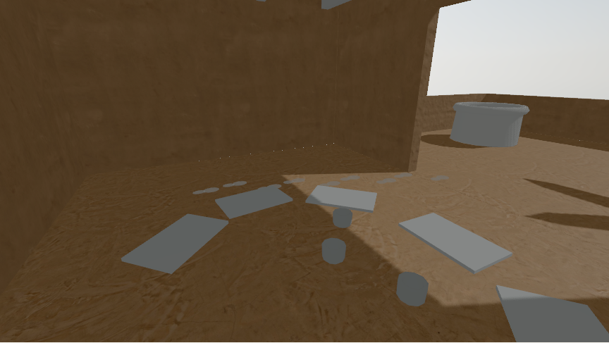

The 632 frame shows several broad mats from the older loose-circle arrangement, three plain cups, and small pale floor marks near the back wall. The 661 low table, two floor bags, waterskin, and three wall pegs are absent, as is the 680 bright oval floor trace. The former bag area contains exposed floor and edges of two mats, not an empty version of the later scene. Some outer mats extend beyond the frame; the central objects are distinct. A faint dotted bright line is visible at the rear floor/wall junction in all three captures, away from the bag area, with no new artifact apparent around the 632 floor there. Across the three matched images the room shell and camera stay fixed, while props, mat layout, and some sun/shadow shapes change. This comparison supports the implemented three-date visual sequence, not a claim that the bags or floor trace were historical belongings.

This is one software-rendered PCF view. It does not establish student legibility, real-device performance, or VSM behavior at this camera. Normal visits remain shadow-free, PCF remains the diagnostic default, and no renderer or room source changed for this capture.

## Matched 632 pegs-wall follow-up · 2026-10-14

From a fresh production build, open the PCF diagnostic URL above in Chromium 154, select 632 and the pegs place, then look right and left to settle the canvas. This matches the [661 pegs](#matched-661-pegs-filter-and-date-review--2026-10-14) and [680 pegs](#matched-680-pegs-filter-review--2026-10-14) PCF captures at camera `(2, 1.6, -1.35)`, yaw `1.571`, pitch `-0.100`. The capture uses the Qwantani morning sky, 1440 × 900 viewport, DPR 1, reduced motion, and SwiftShader WebGL2. Its canvas buffer is 864 × 486 and the PNG is 864 × 487. It measured 46 draws / 3,481 submitted triangles / 3 renderer calls, completed without script or request failures, and differs from both later-date images.

[Full-size 632 PCF image](632-pegs-shadow-pcf.png)

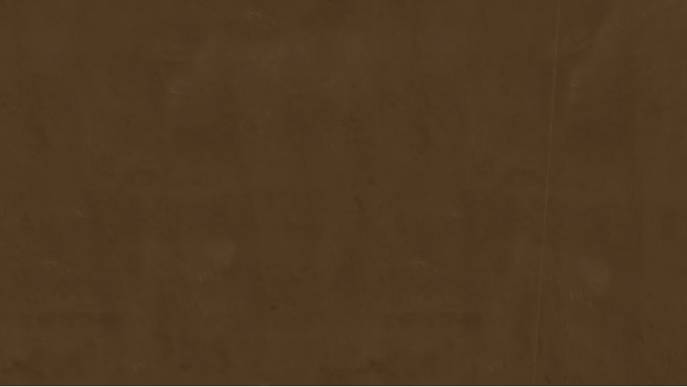

The focal wall is bare in 632: it has no waterskin, travel hook, wall outline, or small peg-and-trace pairs. In 661, a gray waterskin and three separate bare pegs over pale rectangular traces appear. In 680, the three smaller pairs remain while the waterskin area shows a bare hook over a tall pale outline. Pixel differences across the three PCF images stay in that prop area (`x=235..578, y=202..352` overall); the faint vertical seam near the far-right edge and the surrounding wall texture do not change. No prop is clipped, and no new shadow artifact is apparent in this matched view.

The floor bags, clean floor patch, mats, and yard palm are outside this close wall frame. This PCF comparison records the implemented invented visual sequence, not historical evidence, student legibility, or real-device performance. The matched 632 VSM result follows below. Normal visits remain shadow-free, PCF remains the diagnostic default, and no renderer or room source changed for this capture.

## Matched 632 pegs PCF/VSM completion · 2026-10-14

From a fresh production build, open the VSM diagnostic URL above in Chromium 154, select 632 and the pegs place, then look right and left to settle the canvas. This matches the 632 PCF capture immediately above: camera `(2, 1.6, -1.35)`, yaw `1.571`, pitch `-0.100`, Qwantani morning sky, 1440 × 900 viewport, DPR 1, reduced motion, and SwiftShader WebGL2. Both canvas buffers are 864 × 486 and PNGs are 864 × 487. VSM measured 55 draws / 3,567 submitted triangles / 5 renderer calls versus PCF's 46 / 3,481 / 3. The VSM page completed without script or request failures, and the images differ.

| 632 pegs, PCF | 632 pegs, VSM |
| --- | --- |
| [Full-size image](632-pegs-shadow-pcf.png) | [Full-size image](632-pegs-shadow-vsm.png) |
|  | 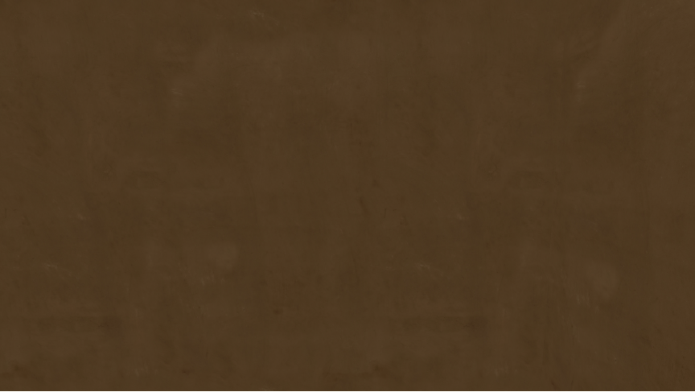 |

The focal wall remains bare in both filters, with no new clipping or broad shadow artifact. A pixel comparison finds 1,676 changed pixels, all in the narrow far-right vertical seam (`x=668..704, y=0..485`); every pixel around the future hook and pegs is identical. The complete PCF-versus-VSM difference image is also pixel-identical for the 632, 661, and 680 pegs pairs. Thus the filter choice changes only that seam in these three matched views, while the dated wall props and traces retain the same appearance. VSM adds 9 draws, 86 submitted triangles, and 2 renderer calls at this 632 pose without a visible gain around the focal wall.

This is a software-rendered comparison of one pose, not a frame-time, real-device, or student legibility result. Normal visits remain shadow-free, PCF remains the diagnostic default, and no renderer or room source changed for this capture.

## Matched 661/680 travel-corner VSM review · 2026-10-14

From a fresh production build, open the VSM diagnostic URL above in separate Chromium 154 pages for 661 and 680. Select the head-of-room place, look left five times and down once, then capture the settled canvas. This matches the [PCF bag pair](#matched-661-and-680-floor-bag-review--2026-10-14) at camera `(-1.55, 1.6, -3.65)`, yaw `2.042`, pitch `-0.340`, with the Qwantani morning sky, 1440 × 900 viewport, DPR 1, reduced motion, and SwiftShader WebGL2. Both buffers are 864 × 486 and PNGs are 864 × 487. The 661 VSM frame measured 110 draws / 5,691 submitted triangles / 5 renderer calls (PCF: 108 / 5,689 / 3); the 680 VSM frame measured 101 / 4,359 / 5 (PCF: 99 / 4,357 / 3). Both VSM pages completed without script or request failures and differ from their PCF counterparts and each other.

| 661 floor bags, VSM | 680 floor trace, VSM |
| --- | --- |
| [Full-size image](661-bags-shadow-vsm.png) | [Full-size image](680-bags-shadow-vsm.png) |
| 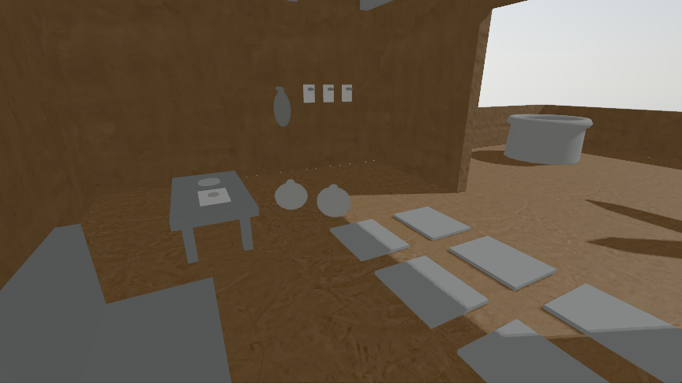 | 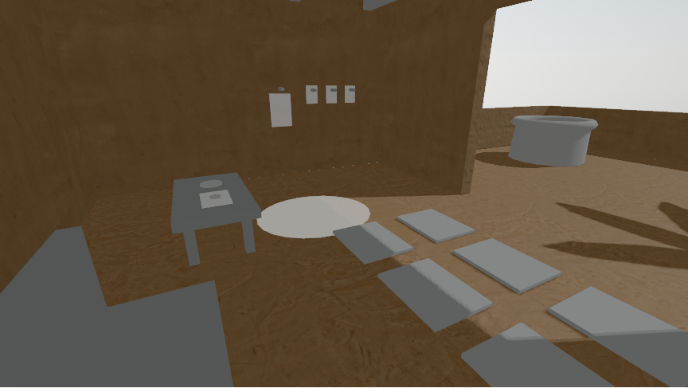 |

The two gray bags remain separate, unclipped forms in 661 VSM. The 680 oval remains broad and bright, with a curved edge distinguishable beside the table and nearest mat; it stays separate from the angular sunlit area farther right. The wall's waterskin-to-empty-hook change also remains visible. Comparing each date with PCF, VSM makes the nearby mats' fine striping much less apparent and changes some right-side floor and yard shading; the coarse mat shadow boundaries remain. The filter differences begin around the second bag and extend across the mats and yard (`x=398..863` overall); the left bag, small wall objects, and table marks look unchanged. No new clipping or obvious artifact appears around the bags or oval. VSM does not visibly improve the bag or oval reading at this pose, and the date-driven yard changes mean the full 661/680 image difference cannot be attributed only to the bags.

These are invented interpretive objects and traces, not evidence of historical belongings. This one software-rendered pose cannot establish student legibility, frame time, or real-device performance. Normal visits remain shadow-free, PCF remains the diagnostic default, and no renderer or room source changed for these captures.

## Matched 632 travel-corner PCF/VSM completion · 2026-10-14

From a fresh production build, open the VSM diagnostic URL above in Chromium 154, select 632 and the head-of-room place, then look left five times and down once before capturing the settled canvas. This matches the [632 PCF travel-corner view](#matched-632-travel-corner-follow-up--2026-10-14) at camera `(-1.55, 1.6, -3.65)`, yaw `2.042`, pitch `-0.340`, with the Qwantani morning sky, 1440 × 900 viewport, DPR 1, reduced motion, and SwiftShader WebGL2. Both buffers are 864 × 486 and PNGs are 864 × 487. VSM measured 100 draws / 4,691 submitted triangles / 5 renderer calls versus PCF's 91 / 4,605 / 3. The VSM page completed without script or request failures and its image differs from PCF and the later VSM dates.

| 632 travel corner, PCF | 632 travel corner, VSM |
| --- | --- |
| [Full-size image](632-bags-shadow-pcf.png) | [Full-size image](632-bags-shadow-vsm.png) |
|  | 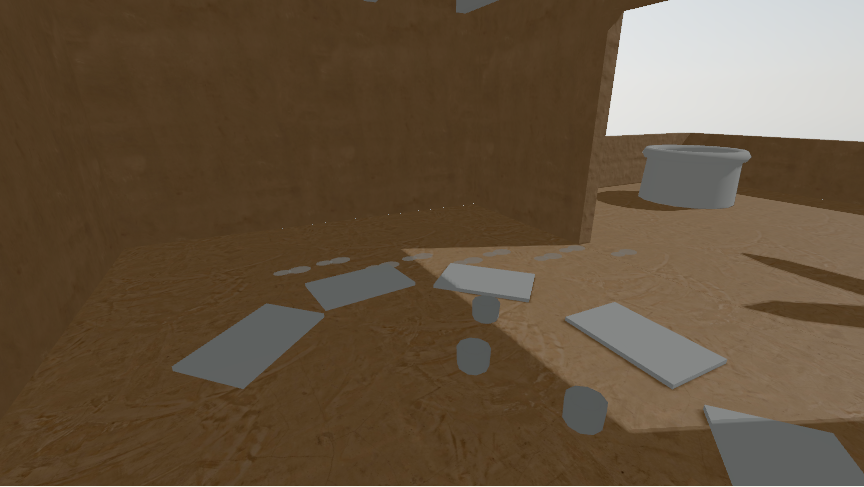 |

The older loose-circle mats, three separate cups, and pale marks near the back wall remain in the same places and clear in VSM. The 632 mats are already plain gray in PCF, so they do not lose the fine striping seen on the later dates' mats. The faint dotted line at the rear floor/wall boundary persists. Filter differences are subtle around the central diagonal sun/shadow boundary, some mat edges, the right yard floor and vessel, and the far-right wall edge. Pixel comparison finds 9,835 changed pixels, within `x=398..863, y=2..437`; the focal mat and cup interiors remain visually unchanged. There is no new clipping, broad light leak, or central object artifact; some outer mats extend beyond the frame in both filters.

Together with the [later VSM pair](#matched-661680-travel-corner-vsm-review--2026-10-14), this completes a three-date filter comparison at one head camera pose: older mats and cups in 632, two bags beside a low table in 661, and a bright oval trace in their place in 680. The changing layout and yard shadows mean date-to-date image differences are broader than the bags alone. These invented scenes are not historical evidence, and these software-rendered captures do not establish student legibility, frame time, or real-device performance. Normal visits remain shadow-free, PCF remains the diagnostic default, and no renderer or room source changed for this capture.
