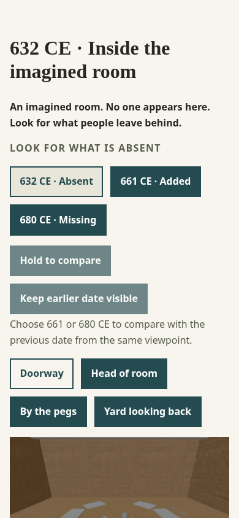
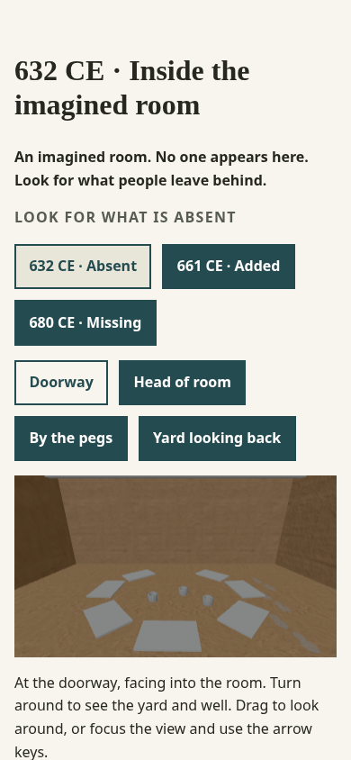

# Phase 0 small-screen layout audit

**Checkpoint: 390 × 844 Chromium viewport, 2026-10-13.** This is an emulated mobile browser check, not a real-phone or screen-reader test. The WebGL2 fallback and reduced motion were used so the room was still during capture.

| Before | After |
| --- | --- |
|  |  |

On entry before the change, the scene frame started at `y=712` and ended at `y=913`; only 132 of its 201 pixels fit in the 844-pixel viewport. The disabled Compare buttons and help text occupied space above the scene. The reading page itself fit the width and remained readable; see the [reading capture](mobile-reading-390.png).

The Compare buttons and their help text now follow the scene and its orientation help in document order. Date and place controls still precede the canvas. On entry, the frame spans `y=528..730` in both 632 and 661, so the whole view is visible without scrolling. The document stays 390 pixels wide at this viewport. The mobile browser regression check asserts full scene visibility at both dates and no horizontal overflow.

The emulated touch pass could select 661, choose Yard, pause motion, return to reading, and open room and reading disclosures. The complete automated browser suite also passed. Real phone, Safari/iPad, WebGPU hardware, and screen-reader checks remain open under the plan.
