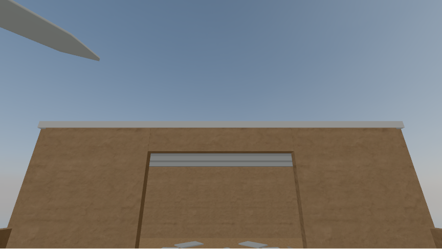
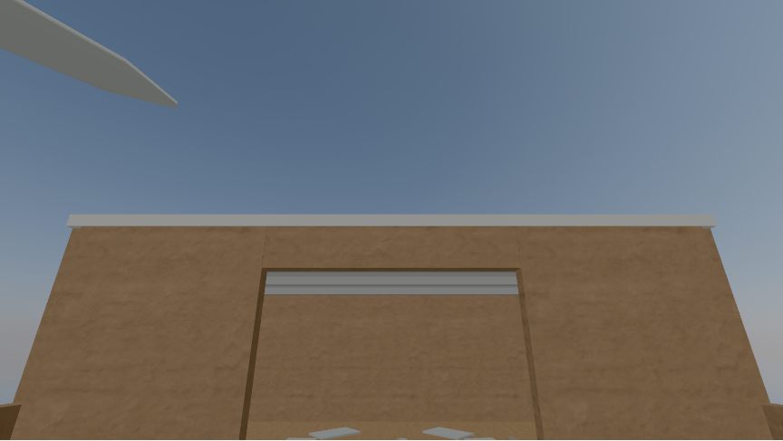

# Phase 0 clear-morning sky comparison

**Status: two candidates captured; Qwantani morning provisionally selected as the default.** The [Phase 0 plan](../PLAN.md#phases) calls for a same-view A/B sky comparison. These are modern Poly Haven stock skies used to judge the imagined room's look. They are not evidence for the light or landscape of a seventh-century place.

| Qwantani morning | Qwantani mid-morning |
| --- | --- |
|  |  |

## Controlled capture

Both images use the 632 CE yard, camera position `(0, 1.6, 4.4)`, yaw `0.000`, pitch `0.360`, a 65° field of view, and an 864 × 486 canvas. They were captured in Chromium with the WebGL2 fallback on SwiftShader at device scale factor 1. The capture script selects the yard under reduced motion, presses Look up four times, and checks the date, pose, renderer, and canvas dimensions match before saving either image. Run `PLAYWRIGHT_CHROMIUM_EXECUTABLE_PATH=/usr/bin/chromium npm run capture:sky` to reproduce them.

Only `scene.background` changes between images. The room geometry, wall and floor textures, ambient light (intensity 1.2), directional light (intensity 2.0), AgX tone mapping, and exposure remain fixed. The HDRIs do not light the room in this comparison. Ordinary visits use Qwantani morning as a provisional background; `?sky=qwantani_mid_morning_puresky` overrides it for comparison. `?sky=qwantani_morning_puresky` explicitly selects the default candidate.

For live review, open the [default morning view](https://wangy113.github.io/after-632-gpt-sol-6/?gl=1) or [mid-morning override](https://wangy113.github.io/after-632-gpt-sol-6/?gl=1&sky=qwantani_mid_morning_puresky), enter the room, choose **Yard**, and look up four times. These links force the same WebGL2 fallback used for the captures.

| Candidate | Poly Haven source | Pinned 1k HDR | Size | MD5 |
| --- | --- | --- | ---: | --- |
| Morning | [qwantani_morning_puresky](https://polyhaven.com/a/qwantani_morning_puresky) | [file](https://dl.polyhaven.org/file/ph-assets/HDRIs/hdr/1k/qwantani_morning_puresky_1k.hdr) | 1,118,343 bytes | `0458a3c3dcb2c4b6e19d469a16611335` |
| Mid-morning | [qwantani_mid_morning_puresky](https://polyhaven.com/a/qwantani_mid_morning_puresky) | [file](https://dl.polyhaven.org/file/ph-assets/HDRIs/hdr/1k/qwantani_mid_morning_puresky_1k.hdr) | 1,121,866 bytes | `798068e149c607fa1639cbbcd5f6b66a` |

Both files are [CC0](https://polyhaven.com/license). Their source pages and API file records are pinned in [`assets.config.json`](../../assets.config.json), and `npm run check:assets` verifies both committed and built copies. The two skies add 2,240,209 bytes; the asset check measures the full production build against the 15,000,000-byte budget.

## What the screenshots show

Both candidates look like a clear blue morning sky at this pose. Morning appears lighter: a sky-only sample from pixels `x=210..779, y=30..209` averages RGB `(116, 137, 160)`, versus `(97, 118, 141)` for mid-morning. The wall and roof composition appears stable, as expected with fixed lighting. The roof and yard geometry are still a prototype, and neither image establishes a historically plausible sky.

Morning is the provisional default because its lighter sky may help legibility while retaining the clear-morning look. This choice still needs human review for legibility and restraint. The planned sun patch through the doorway cannot be judged here: this prototype has no shadow-casting sun setup. The gray-box participant study and instructor/community review remain open.
