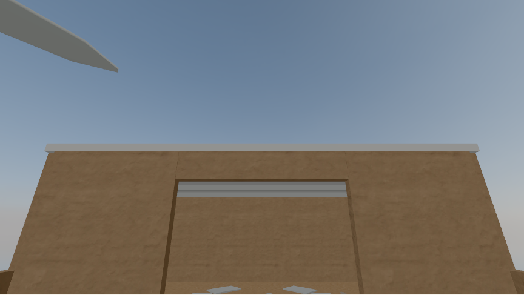
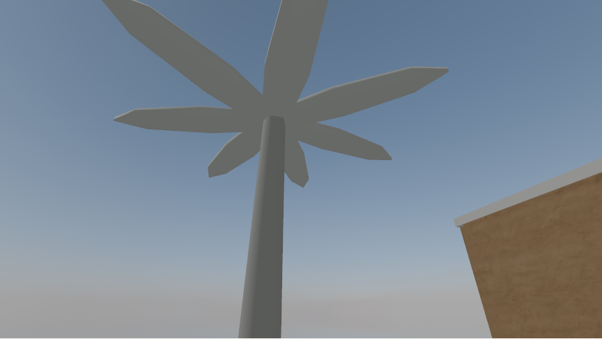

# Low 512-pixel HDR skies · 2026-10-16

Exact `?tier=low` now selects a 512 × 256 HDR background for either Qwantani sky candidate, alongside the [512-pixel wall and floor maps](LOW_512_TEXTURES.md) and DPR 1 cap. The normal URL keeps the pinned 1024 × 512 HDR, 1k maps, and DPR 1.5 cap. Sky choice is still independent: `?sky=qwantani_mid_morning_puresky` selects the alternate candidate in either tier. A diagnostic `?tier=low&skyResolution=1k` keeps Low's maps and drawing resolution while using the original HDR for a fair sky-only comparison.

## Source and derivation

Poly Haven's Files API lists 1k as the smallest HDR resolution for [Qwantani morning](https://api.polyhaven.com/files/qwantani_morning_puresky) and [Qwantani mid-morning](https://api.polyhaven.com/files/qwantani_mid_morning_puresky). The two committed 1k HDRs remain pinned by their Poly Haven URLs, byte sizes, and MD5 hashes in [the asset manifest](../../assets.config.json). Both are CC0 stock skies used only as visual candidates, not historical evidence.

`npm run generate:low-skies` uses the pinned Three.js 0.186.1 HDRLoader in Float32 mode to decode each original. It averages each 2 × 2 pixel square in linear RGB, then writes a 512 × 256 Radiance RGBE image with deterministic scanline RLE. The manifest records this recipe and each output's size and SHA-256. It verifies existing derivatives byte for byte or creates missing ones. `npm run check:assets` checks committed and built files, dimensions, hashes, exact file sets, and retained HDR highlights. The smaller files retain luminance above 10 in decoded pixels; the resize reduces peak values by averaging bright source pixels, as expected.

| Candidate | 1k HDR source | Low HDR source | Source saving |
| --- | ---: | ---: | ---: |
| Qwantani morning | 1,118,343 B | 306,120 B | 72.6% |
| Qwantani mid-morning | 1,121,866 B | 308,787 B | 72.5% |

The two Low HDRs total 614,907 B versus 2,240,209 B for their 1k sources. The production build contains both sizes of both skies and both sizes of six maps: **6,582,330 B** against the 15,000,000 B full-site budget. The first view remains **45,817 B** against 300,000 B because room assets load only after entry.

## Matched browser comparison

From a checkout with Chromium installed:

```sh
npm run generate:low-skies
npm run check:assets
PLAYWRIGHT_CHROMIUM_EXECUTABLE_PATH=/usr/bin/chromium node scripts/measure-low-sky.mjs
PLAYWRIGHT_CHROMIUM_EXECUTABLE_PATH=/usr/bin/chromium npm run measure:tier
```

`check:assets` builds the site before the focused sky script serves `dist/`. The sky script uses fresh Chromium 154 contexts for each candidate and HDR size, a 1440 × 900 viewport, DPR 1, reduced motion, and SwiftShader WebGL2. It keeps Low's six maps, lights, camera, and 864 × 486 drawing buffer fixed. It compares the 632 yard looking up above the roof, the turned 632 yard palm, and the same turned palm at 680. Each of the four visits requested exactly six 512-pixel maps and its selected HDR at HTTP 200, with no page or request errors. Camera pose, buffer, and two renderer calls matched within each sky pair. Draw and triangle counters varied across repeated settled frames of the **same** sky and reversed which resolution was higher when run order changed, so they cannot support a sky-resolution work claim; the script prints their ranges as diagnostics.

| Candidate and Low sky | HDR source file | Encoded HDR HTTP body | Six Low map HTTP bodies | Seven asset HTTP bodies |
| --- | ---: | ---: | ---: | ---: |
| Morning, 1k control | 1,118,343 B | 584,497 B | 941,300 B | 1,525,797 B |
| Morning, 512 | 306,120 B | 164,520 B | 941,300 B | 1,105,820 B |
| Mid-morning, 1k control | 1,121,866 B | 565,073 B | 941,300 B | 1,506,373 B |
| Mid-morning, 512 | 308,787 B | 155,628 B | 941,300 B | 1,096,928 B |

For the default morning candidate, the smaller sky saves **419,977 encoded HTTP body bytes** beyond Low's smaller maps, a 27.5% reduction from the prior Low seven-asset response. Current normal maps and sky total 2,390,880 encoded HTTP body bytes; current Low totals 1,105,820, **53.7% less**. HTTP body bytes exclude headers, HTML, scripts, and the arrival still; they differ from source-file bytes because the HDR response is compressed in transit. The built-site total above includes every variant and is a third measure.

## Image review

Each pair is the same Low room at DPR 1; only its HDR size changes. The captures are 864 × 487 PNGs because Playwright rounds the screenshot boundary. Across all six pairs, a raw RGB comparison found a maximum channel difference of **1 level out of 255**. In the sampled frames, the sky gradient remains smooth and the roof and palm silhouettes remain visible without a new seam or missing object. This is a software-rendered comparison at these poses, not a visitor-readability result.

| Morning, 632 looking up: 1k control | Morning, 632 looking up: 512 Low HDR |
| --- | --- |
|  |  |

| Morning, 680 turned palm: 1k control | Morning, 680 turned palm: 512 Low HDR |
| --- | --- |
|  |  |

| Candidate and pose | 1k control | 512 Low HDR |
| --- | --- | --- |
| Morning, 632 looking up | [Image](sky-low-qwantani_morning_puresky-1k-632-up.png) | [Image](sky-low-qwantani_morning_puresky-512-632-up.png) |
| Morning, 632 turned palm | [Image](sky-low-qwantani_morning_puresky-1k-632-palm.png) | [Image](sky-low-qwantani_morning_puresky-512-632-palm.png) |
| Morning, 680 turned palm | [Image](sky-low-qwantani_morning_puresky-1k-680-palm.png) | [Image](sky-low-qwantani_morning_puresky-512-680-palm.png) |
| Mid-morning, 632 looking up | [Image](sky-low-qwantani_mid_morning_puresky-1k-632-up.png) | [Image](sky-low-qwantani_mid_morning_puresky-512-632-up.png) |
| Mid-morning, 632 turned palm | [Image](sky-low-qwantani_mid_morning_puresky-1k-632-palm.png) | [Image](sky-low-qwantani_mid_morning_puresky-512-632-palm.png) |
| Mid-morning, 680 turned palm | [Image](sky-low-qwantani_mid_morning_puresky-1k-680-palm.png) | [Image](sky-low-qwantani_mid_morning_puresky-512-680-palm.png) |

The sky remains a background only; fixed prototype room lights are unchanged. The laptop, Chromebook, and phone still need real-device frame-time and readability checks before selecting a tier automatically. The source skies' visual and historical suitability still needs instructor and community review.
