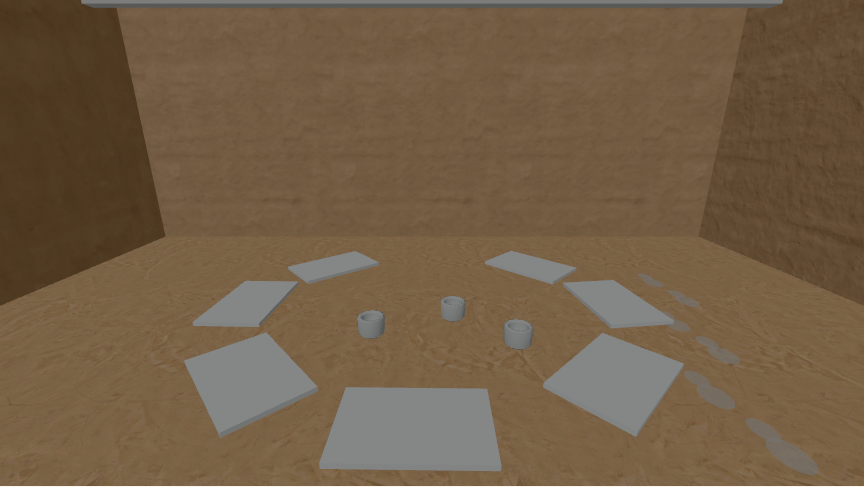
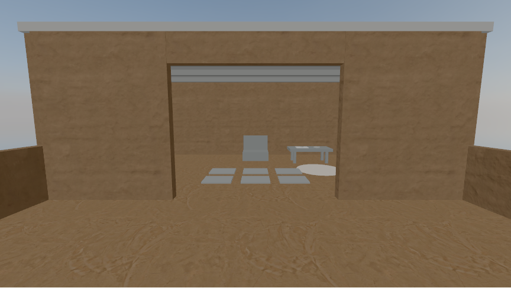

# Low 512-pixel texture preview · 2026-10-15

Exact `?tier=low` now uses six 512-pixel WebP wall and floor maps as well as the [earlier DPR 1 cap](LOW_TIER_PREVIEW.md). The normal URL keeps its six pinned 1k JPG maps and DPR 1.5 cap. Both use the selected 1k sky HDR, the same room geometry, and the same antialiasing setting. Tier selection is still manual.

## Source and reproducibility

The wall and floor candidates are Poly Haven's CC0 `clay_plaster` and `clay_floor_001`. Their Files API offers no native 512-pixel maps. Each Low map is derived from the corresponding committed, MD5-pinned 1024 × 1024 JPG with **Sharp 0.35.5**, resized to 512 × 512 using Lanczos3. Diffuse maps use WebP quality 90; normal and ARM maps use lossless WebP encoding after resizing. “Lossless” describes that encoding step, not an exact copy of the larger source. [The asset manifest](../../assets.config.json) records the full recipe, each source URL and MD5, and each derivative's filename, byte size, and SHA-256 hash.

From a checkout with dependencies installed, verify the committed source and derivative files and reproduce the Low maps with:

```sh
npm run generate:low-textures
npm run check:assets
```

`generate:low-textures` verifies the pinned source bytes and generated output. It creates a missing Low file or checks a committed one byte for byte. `check:assets` checks the committed and built files plus the first-view and full-site budgets. Both commands work offline.

| Committed files for the default sky visit | Normal | Low |
| --- | ---: | ---: |
| Six wall and floor maps | 1,806,383 B | 941,300 B |
| Morning 1k HDR source | 1,118,343 B | 1,118,343 B |
| Seven source files used by a visit | 2,924,726 B | 2,059,643 B |

The Low maps total **52.1%** of the normal map bytes, saving **865,083 B** of source files per room visit. The site build includes both map variants and both sky candidates: **5,966,614 B** against the 15,000,000 B full-site budget. The reading page and arrival still remain **45,817 B** against the 300,000 B first-view budget because room assets load only after entry.

## Matched browser check

Reproduce the transfer and drawing-buffer measurements, then refresh the texture-only images below:

```sh
PLAYWRIGHT_CHROMIUM_EXECUTABLE_PATH=/usr/bin/chromium npm run measure:tier -- --capture-textures
```

The script builds the production site and serves it locally. It uses fresh Chromium 154 contexts for each tier, a 1440 × 900 CSS viewport, emulated DPR 2, reduced motion, and SwiftShader's WebGL2 fallback. It samples settled 632 doorway and 680 yard poses after a matched right/left look. In each context, all seven expected assets returned HTTP 200 with no page or request errors: the normal visit requested exactly six `_1k.jpg` maps, Low requested exactly six `_512.webp` maps, and both requested the same 1k morning HDR.

| Tier | View | CSS canvas | Drawing buffer | Buffer pixels | Draws | Triangles | Renderer calls |
| --- | --- | --- | --- | ---: | ---: | ---: | ---: |
| Normal | 632 doorway | 864 × 486 | 1296 × 729 | 944,784 | 61 | 3,077 | 2 |
| Low | 632 doorway | 864 × 486 | 864 × 486 | 419,904 | 61 | 3,077 | 2 |
| Normal | 680 yard | 864 × 486 | 1296 × 729 | 944,784 | 48 | 2,781 | 2 |
| Low | 680 yard | 864 × 486 | 864 × 486 | 419,904 | 48 | 2,781 | 2 |

Low retains **44.4%** of the normal drawing-buffer pixels at emulated DPR 2. The sampled draw, triangle, and renderer-call counts remain equal; these counters do not measure GPU time.

| Encoded response bodies in the local browser check | Normal | Low |
| --- | ---: | ---: |
| Six requested maps | 1,806,383 B | 941,300 B |
| Requested 1k sky | 584,497 B | 584,497 B |
| Maps plus sky | 2,390,880 B | 1,525,797 B |

The combined asset response bodies are **36.2% smaller** in Low. These are encoded HTTP body sizes from the local preview, excluding headers, HTML, scripts, and the arrival still. The HDR response is compressed in transit, which is why its 584,497 B response body differs from its 1,118,343 B committed source size. The full built-site size above is a third measure and includes both variants.

## Texture-only visual comparison

For these captures, the script repeats each pose at emulated DPR 1. Both variants then have the same camera pose, 864 × 486 CSS canvas, and 864 × 486 drawing buffer, leaving map selection as the intended rendering difference. Playwright's screenshots are 864 × 487 PNGs because of capture-boundary rounding.

| Normal 632 doorway | Low 632 doorway |
| --- | --- |
| [Open full image](texture-632-doorway-baseline.png) | [Open full image](texture-632-doorway-low.png) |
|  |  |

| Normal 680 yard | Low 680 yard |
| --- | --- |
| [Open full image](texture-680-yard-baseline.png) | [Open full image](texture-680-yard-low.png) |
|  |  |

Low materials look a little smoother in these software-rendered frames. No missing room material, prop, dated mark, or visible seam was observed in the matched images. These captures do not show how well visitors recognize the intended cues on a physical screen.

## Remaining Phase 4 work

The 1k sky remains unchanged. There is no irradiance bake, GTAO, or FXAA in this prototype to reduce or disable. Automatic tier selection, any antialiasing change, and a possible smaller sky or bake require separate evidence. The local Chromium measurements establish requested asset sets, bytes, drawing buffers, and submitted work; they do not establish real-device frame rate, memory use, or readability. Test the planned laptop, Chromebook, and phone before choosing a default tier.
