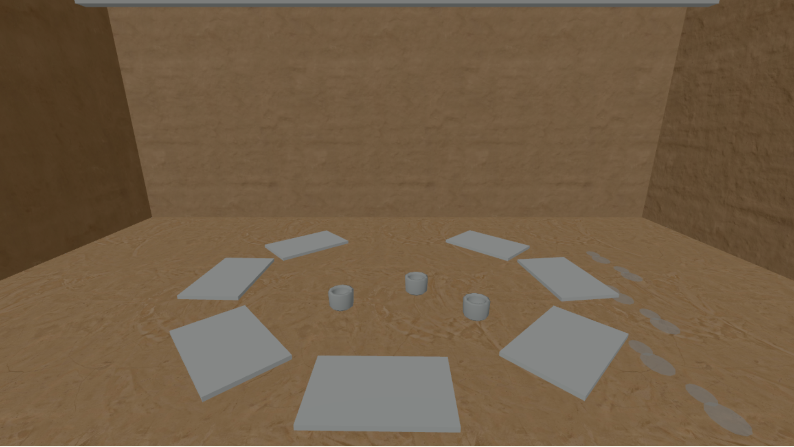
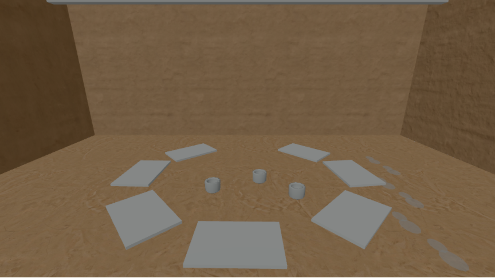

# Explicit Low rendering preview · 2026-10-15

The first Phase 4 rendering option is an opt-in `?tier=low` preview. It caps the room renderer's device pixel ratio at **1**. A regular visit, or an unrecognized `tier` value, keeps the existing **1.5** cap. The option changes the canvas drawing-buffer size; it does not select a tier automatically or change the authored scene.

## Matched measurement

Run from a checkout with dependencies installed and Chromium available:

```sh
PLAYWRIGHT_CHROMIUM_EXECUTABLE_PATH=/usr/bin/chromium npm run measure:tier -- --capture
```

The command builds the production site, serves it locally, and samples settled 632 doorway and 680 yard views in Chromium 154's SwiftShader WebGL2 fallback. It fixes the browser viewport at 1440 × 900 CSS pixels, emulates device pixel ratio 2, requests reduced motion, and uses the same camera pose for each tier. At each pose it turns right and back left before reading the canvas buffer and render counters. `--capture` writes the matched 632 doorway images below.

| Tier | View | Canvas CSS size | Drawing buffer | Buffer pixels | Draw calls | Triangles | Renderer calls |
| --- | --- | --- | --- | ---: | ---: | ---: | ---: |
| Baseline | 632 doorway | 864 × 486 | 1296 × 729 | 944,784 | 61 | 3,077 | 2 |
| Low | 632 doorway | 864 × 486 | 864 × 486 | 419,904 | 61 | 3,077 | 2 |
| Baseline | 680 yard | 864 × 486 | 1296 × 729 | 944,784 | 48 | 2,781 | 2 |
| Low | 680 yard | 864 × 486 | 864 × 486 | 419,904 | 48 | 2,781 | 2 |

The Low buffer contains **44.4% as many pixels** as the baseline buffer at this emulated DPR, a reduction of 55.6%. Scene draw calls, submitted triangles, and renderer calls are equal at the two matched poses. These counters describe submitted geometry and render passes; they do not measure shaded pixels, GPU time, frame rate, or memory use.

| Baseline doorway | Low doorway |
| --- | --- |
| [Open full image](tier-632-doorway-baseline.png) | [Open full image](tier-632-doorway-low.png) |
|  |  |

In these software-rendered captures, Low has slightly softer edges. The mat circle, cups, footprints, and room geometry remain visible at the same camera pose. This is a visual inspection of two saved frames, not a visitor legibility result.

## Scope and next checks

The prototype currently has no GTAO, FXAA, or irradiance bake to vary by tier. Low keeps the same multisample antialiasing setting, six pinned 1k JPG texture maps, and selected 1k sky HDR as baseline. Those seven default-scene assets total **2,924,726 source bytes** (1,806,383 for textures plus 1,118,343 for the morning sky), so this preview offers **no asset-transfer saving**. The `?shadows=1` diagnostic remains opt-in in either tier; normal visits have shadows off.

The full Phase 4 target still needs automatic tier selection, a separate 512-pixel texture set with pinned provenance, a reviewed antialiasing path such as FXAA, and a smaller bake if a bake is added. This emulated Chromium result cannot establish performance on the planned laptop, Chromebook, or phone. Measure frame time and inspect readability on those devices before choosing a default tier.
